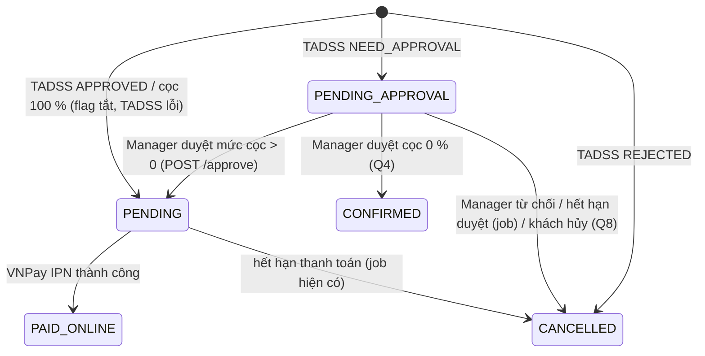

# ĐẶC TẢ API SMASHCOURT-BE ↔ SMASHCOURT-FE: CỌC, CHỜ DUYỆT, DUYỆT

| | |
| :--- | :--- |
| **Trạng thái** | Đặc tả cho **Phase 6**, **chưa hiện thực** trong mã BE/FE. Viết ngày 12/10/2026 (task T5.22 / M-08, gói 5.7 của TADSS-Runtime); **đã review 18/10/2026 (T5.29)**: đối chiếu với mã BE, sửa R-1…R-8 (Mục 10), chốt Q1…Q12 (Mục 9) |
| **Sở hữu** | Tài liệu này là nguồn duy nhất của hợp đồng **BE ↔ FE** cho luồng cọc, chờ duyệt, duyệt/từ chối |
| **Không sở hữu** | Hợp đồng **BE ↔ TADSS** (request/response `/api/v2/decisions`, mã lỗi TADSS, idempotency, header): [`INTEGRATION_SPEC.md`](../../../TADSS-Runtime/docs/contracts/INTEGRATION_SPEC.md) Mục 1–4. Khi hai tài liệu khác nhau về phía TADSS, INTEGRATION_SPEC đúng |
| **Người review** | T5.29, 18/10/2026: review và chốt câu hỏi mở cùng người dùng. SV2 đọc lại khi bắt đầu Epic 6B |
| **Hiện thực** | Phase 6: BE (Epic 6A), FE (Epic 6B). OpenAPI của các endpoint dưới đây sẽ được sinh từ mã (Swagger) khi hiện thực; khi đó tài liệu này vẫn là nguồn cho ngữ nghĩa, mã lỗi và sự kiện SignalR |

Các quyết định đã chốt (11/10/2026), không mở lại trong tài liệu này:

1. FE chỉ định danh đơn chờ duyệt bằng `bookingId`. FE **không bao giờ** thấy `decisionId` của TADSS; BE tra `tadss_decision_id` đã lưu trên booking/hóa đơn (INTEGRATION_SPEC §4.4) rồi gọi override của TADSS.
2. Hàng chờ duyệt được đọc từ **database của BE** (booking `PENDING_APPROVAL`, `approvalExpiresAt > now`), không gọi `GET /api/v2/decisions/pending-approvals` của TADSS mỗi lần mở hàng chờ (endpoint đó giữ cho đối soát/vận hành).
3. Manager nhập mức cọc dạng **phần trăm**; FE gửi **tỷ lệ** `depositRate` (0…1, tối đa 4 chữ số thập phân); BE gửi `deposit.rate` cho TADSS; TADSS quy đổi ra số tiền; FE hiển thị số tiền do BE trả về.
4. Khi duyệt/từ chối **không có** đường lùi "cọc 100 %" (khác lúc đặt sân): TADSS không phản hồi / 5xx / 401 / 429 ⇒ Manager được báo thử lại, booking vẫn `PENDING_APPROVAL`.
5. Trạng thái booking của BE là nguồn sự thật (INTEGRATION_SPEC §4.3): không hồi sinh booking đã hết hạn/đã hủy chỉ vì override trả 200; job hết hạn duyệt hủy booking và giải phóng sân, **không bao giờ tự duyệt**.
6. Chỉ booking `ONLINE` đi qua TADSS; booking `WALK_IN` không bao giờ có quyết định cọc.

---

## 1. Trạng thái, phạm vi và quy ước

### 1.1. Phạm vi

| Trong phạm vi | Ngoài phạm vi |
| :--- | :--- |
| Thay đổi response của `POST /api/bookings/online`, các endpoint chi tiết/danh sách booking của khách và của nhân viên, `POST /api/me/bookings/{id}/retry-payment` | Wire JSON giữa BE và TADSS (INTEGRATION_SPEC §3) |
| Ba endpoint mới: hàng chờ duyệt, duyệt, từ chối | Cách BE lưu cột mới trong DB (INTEGRATION_SPEC §4.4, chi tiết hóa ở Phase 6) |
| Mã lỗi BE mới (đề xuất), sự kiện SignalR mới (đề xuất) | Job báo outcome cho TADSS (không nhìn thấy từ FE) |
| Tình huống biên mà FE phải xử lý; truy vết E2E-01…E2E-14 | Nội dung email gửi khách (chỉ nêu lúc gửi) |

### 1.2. Vai trò và policy

Policy lấy từ `Configurations/AuthorizationPolicies.cs` (tên thật):

| Endpoint | Policy | Ai được gọi | Phạm vi dữ liệu |
| :--- | :--- | :--- | :--- |
| `POST /api/bookings/online` | không yêu cầu đăng nhập (như hiện tại) | Khách đã đăng nhập, khách vãng lai | — |
| `GET /api/me/bookings`, `GET /api/me/bookings/{id}`, `POST /api/me/bookings/{id}/retry-payment` | `CustomerOnly` (như hiện tại) | `CUSTOMER` | Booking của chính khách |
| `GET /api/bookings`, `GET /api/bookings/{bookingId}`, `GET /api/bookings/details/{id}` | `StaffAndAbove` (như hiện tại) | `OWNER`, `BRANCH_MANAGER`, `STAFF` | `OWNER` mọi chi nhánh; Manager/Staff chi nhánh của mình |
| `GET /api/bookings/pending-approval` | **`OwnerOrManager`** | `OWNER`, `BRANCH_MANAGER` | `BRANCH_MANAGER` chỉ chi nhánh được gán; `OWNER` mọi chi nhánh |
| `POST /api/bookings/{bookingId}/approve`, `/reject` | **`OwnerOrManager`** | `OWNER`, `BRANCH_MANAGER` | `BRANCH_MANAGER` chỉ booking thuộc chi nhánh được gán; `OWNER` mọi booking |

`STAFF` và `CUSTOMER` gọi ba endpoint mới ⇒ 403 do policy (xem 1.3, không theo envelope). Phạm vi chi nhánh dùng `IBranchScopeResolver` (hàng chờ) và kiểm tra `IUserBranchRepository.IsUserInBranchAsync` (duyệt/từ chối) như `BookingService.GetDetailsByIdAsync` đang làm.

### 1.3. Quy ước response (theo mã BE hiện có)

- **Envelope** `ApiResponse<T>` (`Common/ApiResponse.cs`), serialize bằng System.Text.Json với `PropertyNamingPolicy = CamelCase` và **không** bỏ trường `null`, nên luôn có đủ năm khóa theo thứ tự `success`, `code`, `message`, `data`, `errors`:
  - thành công: `ApiResponse<T>.Ok(data, message)` ⇒ `code = "SUCCESS"`, `errors = null`;
  - lỗi nghiệp vụ: `AppException(status, message, ErrorCodes.X)` → `ExceptionMiddleware` ⇒ `success = false`, `data = null`, `errors = null`;
  - lỗi validate model: `InvalidModelStateResponseFactory` (Program.cs) ⇒ 400, `code = "VALIDATION_ERROR"`, `message = "Dữ liệu đầu vào không hợp lệ"`, `errors` là từ điển *tên trường → danh sách thông báo*. Khóa của `errors` **giữ nguyên tên thuộc tính C#** (ví dụ `"DepositRate"`, không phải `depositRate`) vì không cấu hình `DictionaryKeyPolicy`; lỗi giải mã JSON có khóa dạng `"$.depositRate"`.
- **401/403 do lớp xác thực/phân quyền không theo envelope.** `JwtBearerEvents` trong `Program.cs` trả:
  - 401 (chưa đăng nhập/thiếu token, `OnChallenge`): `{ "message": "Unauthorized", "detail": "Bạn chưa xác thực hoặc thiếu token !" }`;
  - 401 (token sai/hết hạn, `OnAuthenticationFailed`): `{ "message": "Invalid token", "detail": "<thông điệp của exception, mặc định \"Token không hợp lệ\">" }`;
  - 403 (đăng nhập nhưng sai vai trò so với policy, `OnForbidden`): `{ "message": "Forbidden", "detail": "Bạn không có quyền truy cập vào tài nguyên này !" }`.
  FE xử lý các trường hợp này theo **HTTP status**. 403 do *nghiệp vụ* (Manager thao tác chi nhánh khác) thì vẫn theo envelope với `code = "FORBIDDEN"`.
- **FE phải rẽ nhánh theo `code`, không theo `message`**, nhất là với 5xx: `smashcourt-fe/src/api/core/apiParser.ts` thay `message` của mọi response ≥ 500 bằng thông báo chung, nên câu hiển thị cho `TADSS_UNAVAILABLE` (503) phải do FE tự chọn theo `code`.
- **Thời gian trong REST** dùng `VietnamDateTimeConverter`: `DateTime` ra JSON dạng `"dd/MM/yyyy HH:mm:ss"` **giờ Việt Nam, không có offset** (khác TADSS dùng ISO 8601 kèm offset). `TimeSpan` ra `"HH:mm:ss"`. Trường kiểu `DateOnly` (DTO mới) ra `"yyyy-MM-dd"`. Chuỗi không có offset nên FE **phải** hiểu là giờ `+07:00` khi cần mốc tuyệt đối (đồng hồ đếm ngược tới `approvalExpiresAt`/`expiresAt`), không dùng múi giờ của trình duyệt (R-6).
- **Thời gian trong SignalR** không đi qua converter trên (`AddSignalR()` dùng cấu hình JSON mặc định của SignalR, camelCase): `DateTime` UTC ra ISO 8601, ví dụ `"2026-11-18T02:15:01.1234567Z"`.
- **Tiền** là số thập phân, đơn vị VND (BE không có trường `currency`). **Tỷ lệ cọc** là số thập phân trong `[0, 1]`, tối đa 4 chữ số thập phân (có thể hiện dạng `0.3000` nếu cột DB có scale 4).
- **Enum** trong DTO là chuỗi (`Status = b.Status.ToString()`), ví dụ `"PENDING_APPROVAL"`; tham số query enum nhận tên (`status=PENDING_APPROVAL`).
- **Phân trang** dùng `PaginationQuery` (`page` ≥ 1, mặc định 1; `pageSize` 1..50, mặc định 10) và trả `PagedResult<T>`: `items`, `page`, `pageSize`, `totalItems`, `totalPages`, `hasNext`, `hasPrev`.
- Giá trị trong ví dụ là **giá trị mẫu**, không phải dữ liệu thật. Mã booking theo định dạng hiện có `BK-yyyyMMdd-######`, hóa đơn `INV-yyyyMMdd-######`.

---

## 2. Thay đổi dữ liệu nhìn thấy từ FE

### 2.1. Trạng thái booking mới `PENDING_APPROVAL`

Thêm giá trị `PENDING_APPROVAL` vào enum `BookingStatus` (C#) và `booking_status` (PostgreSQL), INTEGRATION_SPEC §4.4. Các trạng thái FE gặp trong luồng cọc:

| Trạng thái (`status`) | `paymentStatus` | Ý nghĩa | Hạn | FE hiển thị (gợi ý) |
| :--- | :--- | :--- | :--- | :--- |
| `PENDING` | `UNPAID` | Chờ khách thanh toán cọc (hoặc 100 %) qua VNPay | `expiresAt` | "Chờ thanh toán cọc" |
| `PENDING_APPROVAL` | `UNPAID` | **Mới.** Chờ Manager duyệt mức cọc; slot vẫn được giữ | `approvalExpiresAt` | "Chờ duyệt cọc" |
| `PAID_ONLINE` | `PARTIALLY_PAID` | Đã thanh toán cọc (giữ nguyên hành vi IPN hiện tại: thanh toán online luôn để hóa đơn `PARTIALLY_PAID`) | — | "Đã cọc" |
| `CANCELLED` | `UNPAID` | Bị từ chối, hết hạn duyệt, hết hạn thanh toán hoặc bị hủy | — | "Đã hủy" (kèm lý do nếu có) |

Chuyển trạng thái mới (bổ sung vào `Helpers/BookingStatusTransition.cs`):



- `PENDING_APPROVAL` phải được tính là trạng thái **đang giữ sân** (`BookingStatusTransition.GetActiveStatuses()`), nên lịch sân, time grid, kiểm tra trùng giờ và lịch theo ngày (`GET /api/bookings/schedule`) đều coi slot là đã có người giữ. FE cần màu/nhãn cho trạng thái này ở các màn hình đó.
- Trong lúc BE gọi TADSS khi tạo booking, booking tồn tại ở `PENDING` vài trăm mili giây; FE không thấy trạng thái trung gian này vì response của `POST /api/bookings/online` chỉ trả sau khi có kết quả. Sự kiện `BookingCreated` hiện có được phát **sau** khi có kết quả nên mang trạng thái cuối; câu `message` của sự kiện theo trạng thái cuối ("Chờ thanh toán" / "Chờ duyệt cọc"), không cố định như hiện nay (R-7).
- **Thiết kế ghi dữ liệu (R-5):** BE **không** gọi TADSS bên trong transaction ghi booking (hiện `CreateOnlineAsync` ghi booking, chi tiết sân, hóa đơn, slot lock và Payment trong một `TransactionScope`). Thứ tự: transaction 1 ghi booking `PENDING` + chi tiết + hóa đơn + slot lock (chưa tạo Payment) → gọi TADSS ngoài transaction → transaction 2 áp kết quả bằng cập nhật có điều kiện trạng thái (mức cọc, Payment + URL VNPay, hoặc `PENDING_APPROVAL`, hoặc hủy). BE dừng giữa hai bước thì booking `PENDING` chưa có Payment bị job hủy `PENDING` quá hạn hiện có dọn.
- Lọc danh sách nhân viên theo trạng thái mới chạy được ngay qua `BookingListQuery.status=PENDING_APPROVAL`.

### 2.2. Trường cọc mới trên booking / hóa đơn

Thêm vào `BookingDto` (mọi endpoint đang trả `BookingDto`) và `OnlineBookingResponse`. Nguồn lưu là hóa đơn/booking theo INTEGRATION_SPEC §4.3–4.4.

| Trường JSON | Kiểu | Khi nào có giá trị | Ý nghĩa |
| :--- | :--- | :--- | :--- |
| `depositRate` | number \| null | Đã có mức cọc (`TADSS`, `MANAGER` hoặc `FULL_PAYMENT_FALLBACK`) | Tỷ lệ cọc 0…1. Cọc 100 % ⇒ `1` |
| `depositAmount` | number \| null | Như trên | Số tiền cọc phải/đã thanh toán qua VNPay. Do TADSS quy đổi tại một nơi duy nhất (INTEGRATION_SPEC §3.6): `amount = round(totalPrice × rate)` theo số chữ số thập phân của tiền tệ, làm tròn nửa xa số 0 (`MidpointRounding.AwayFromZero`); VND có 0 chữ số thập phân. `totalPrice` là giá đã gửi TADSS lúc đặt. Trừ nhánh `FULL_PAYMENT_FALLBACK` (= `finalTotal` lúc đặt) |
| `remainingAmount` | number \| null | Như trên | `finalTotal − depositAmount`, tính trên `finalTotal` **hiện tại** của hóa đơn (gồm dịch vụ thêm sau). Số thu tại quầy khi checkout; số đã thu thực tế đọc từ `paymentStatus` |
| `depositSource` | string \| null | Như trên | `TADSS` \| `MANAGER` \| `FULL_PAYMENT_FALLBACK`. Quyết định fallback của runtime TADSS (`APPROVED` 100 %, `fallbackUsed = true`) và `APPROVAL_WINDOW_UNAVAILABLE` đều là `TADSS` (INTEGRATION_SPEC §4.3) |
| `approvalExpiresAt` | string \| null | Booking từng ở `PENDING_APPROVAL` | Hạn Manager duyệt (giờ VN, `dd/MM/yyyy HH:mm:ss`), lấy từ `approvalExpiresAt` của TADSS. Giữ lại sau khi duyệt/hủy để tra cứu |
| `approvalReasonCode`, `approvalReasons` | string \| null, string[] \| null | Chỉ endpoint của **nhân viên** và hàng chờ, booking từng ở `PENDING_APPROVAL` | `reasonCode`/`reasons` của TADSS vì sao cần duyệt. Endpoint của khách luôn trả `null`. Phụ thuộc câu hỏi mở Q6 (lưu thêm cột) |

Quy tắc chung:

- Booking `WALK_IN` và booking online tạo **trước** Phase 6: mọi trường cọc là `null`. FE coi `depositSource = null` là "không áp dụng cọc" (booking online cũ đã trả 100 %).
- Booking đang `PENDING_APPROVAL`: `depositRate`, `depositAmount`, `remainingAmount`, `depositSource` là `null`; `expiresAt` (hạn thanh toán) là `null`.
- `decisionId`, `strategyName`, `executionType`, `fallbackUsed` của TADSS **không bao giờ** xuất hiện trong response cho FE.

Ví dụ `BookingDto` (chỉ trích các trường liên quan; các trường khác giữ nguyên như hiện tại) — booking đã được Manager duyệt 30 % và khách đã thanh toán cọc, `GET /api/bookings/5b0a6f0e-7c0d-4a0e-9a64-0c2e7f1b9a11`:

```json
{
  "success": true,
  "code": "SUCCESS",
  "message": "Lấy booking thành công",
  "data": {
    "id": "5b0a6f0e-7c0d-4a0e-9a64-0c2e7f1b9a11",
    "bookingCode": "BK-20261118-000123",
    "invoiceCode": "INV-20261118-000123",
    "branchId": "1f2e3d4c-0000-4000-8000-000000000001",
    "branchName": "SmashCourt Thủ Đức",
    "bookingDate": "20/11/2026 07:00:00",
    "status": "PAID_ONLINE",
    "source": "ONLINE",
    "courtFee": 240000,
    "serviceFee": 0,
    "loyaltyDiscountAmount": 12000,
    "promotionDiscountAmount": 0,
    "finalTotal": 228000,
    "paymentStatus": "PARTIALLY_PAID",
    "expiresAt": "18/11/2026 10:05:00",
    "depositRate": 0.3,
    "depositAmount": 68400,
    "remainingAmount": 159600,
    "depositSource": "MANAGER",
    "approvalExpiresAt": "18/11/2026 09:45:00",
    "approvalReasonCode": "NO_SHOW_HISTORY_REVIEW",
    "approvalReasons": ["Khách có 3 lần không đến (ngưỡng 2)."]
  },
  "errors": null
}
```

Cùng booking đó qua `GET /api/me/bookings/{id}` (khách): giống trên nhưng `approvalReasonCode = null`, `approvalReasons = null`.

> **Lỗi đã biết, ngoài phạm vi.** `BookingDto.bookingDate` hiện được trả **lệch 7 giờ** (ví dụ ngày chơi 20/11/2026 ra `"20/11/2026 07:00:00"`, như ví dụ trên): `MapToDto`/`MapToDetailDto` dựng giá trị bằng `DateOnly.ToDateTime(TimeOnly.MinValue)` (`DateTimeKind.Unspecified`), và `VietnamDateTimeConverter` coi `Unspecified` là UTC rồi cộng +7 giờ. Đặc tả này **không** sửa lỗi đó và không đổi trường `bookingDate` của `BookingDto`; FE tiếp tục chỉ dùng phần ngày như hiện tại. DTO mới của hàng chờ (`PendingApprovalBookingDto`, Mục 4.1) dùng trường chỉ-ngày `"yyyy-MM-dd"` (`DateOnly`) nên không bị ảnh hưởng.

---

## 3. Endpoint đã có, đổi response

### 3.1. `POST /api/bookings/online`

Request **không đổi** (`CreateOnlineBookingDto`); khách không bao giờ tự chọn mức cọc. HTTP 201 cho hai nhánh tạo được booking; nhánh bị từ chối trả lỗi (Q1).

`OnlineBookingResponse` mới:

| Trường | Kiểu | Ghi chú |
| :--- | :--- | :--- |
| `bookingId` | GUID | Như hiện tại |
| `bookingCode` | string | **Mới**, để trang chờ duyệt hiển thị mã đơn |
| `status` | string | **Mới**: `PENDING` (thanh toán ngay) \| `PENDING_APPROVAL` (chờ duyệt). FE rẽ nhánh theo trường này |
| `paymentUrl` | string \| null | **Đổi thành nullable**: có khi `status = PENDING`, `null` khi `PENDING_APPROVAL` |
| `expiresAt` | string \| null | Hạn thanh toán; **đổi thành nullable** (`null` khi `PENDING_APPROVAL`) |
| `finalTotal` | number | Như hiện tại |
| `depositRate`, `depositAmount`, `remainingAmount`, `depositSource` | xem 2.2 | `null` khi `PENDING_APPROVAL` |
| `approvalExpiresAt` | string \| null | Có khi `PENDING_APPROVAL` |

Bốn trường hợp (ví dụ cùng một request):

```http
POST /api/bookings/online
Content-Type: application/json
```

```json
{
  "bookingDate": "2026-11-20",
  "courts": [
    { "courtId": "c0a8012e-0000-4000-8000-0000000000aa", "startTime": "18:00:00", "endTime": "20:00:00" }
  ],
  "promotionId": null,
  "note": "Cần mượn thêm vợt"
}
```

**(a) TADSS `APPROVED` — thanh toán cọc ngay** (HTTP 201). FE chuyển hướng tới `paymentUrl`; số tiền trên VNPay là `depositAmount`.

```json
{
  "success": true,
  "code": "SUCCESS",
  "message": "Đặt sân online thành công",
  "data": {
    "bookingId": "5b0a6f0e-7c0d-4a0e-9a64-0c2e7f1b9a11",
    "bookingCode": "BK-20261118-000123",
    "status": "PENDING",
    "paymentUrl": "https://sandbox.vnpayment.vn/paymentv2/vpcpay.html?vnp_Amount=11400000&vnp_TxnRef=...&vnp_SecureHash=...",
    "expiresAt": "18/11/2026 09:25:00",
    "finalTotal": 228000,
    "depositRate": 0.5,
    "depositAmount": 114000,
    "remainingAmount": 114000,
    "depositSource": "TADSS",
    "approvalExpiresAt": null
  },
  "errors": null
}
```

**(b) TADSS `NEED_APPROVAL` — chờ Manager duyệt** (HTTP 201). FE hiển thị trang "Chờ duyệt cọc" với `bookingCode` và đồng hồ đếm tới `approvalExpiresAt`; không chuyển tới VNPay.

```json
{
  "success": true,
  "code": "SUCCESS",
  "message": "Đơn đặt sân đang chờ quản lý chi nhánh duyệt mức cọc",
  "data": {
    "bookingId": "5b0a6f0e-7c0d-4a0e-9a64-0c2e7f1b9a11",
    "bookingCode": "BK-20261118-000123",
    "status": "PENDING_APPROVAL",
    "paymentUrl": null,
    "expiresAt": null,
    "finalTotal": 228000,
    "depositRate": null,
    "depositAmount": null,
    "remainingAmount": null,
    "depositSource": null,
    "approvalExpiresAt": "18/11/2026 09:45:00"
  },
  "errors": null
}
```

**(c) TADSS `REJECTED` — bị từ chối theo chính sách** (Q1; HTTP 400, theo tiền lệ `SLOT_UNAVAILABLE` của BE: request hợp lệ nhưng nghiệp vụ không nhận). BE đã hủy booking và giải phóng slot trước khi trả lỗi; `reasons` của TADSS không hiển thị cho khách (Q6); **không** ghi `slot_interest` cho khách (khác `SLOT_UNAVAILABLE`), vì slot vẫn trống (R-8). Strategy mặc định 2.1.0 của TADSS trả `REJECTED` khi khách lặp lại việc giữ chỗ rồi để hết hạn thanh toán (`reasonCode = REPEATED_PAYMENT_EXPIRY`); kịch bản kiểm: E2E-14.

```json
{
  "success": false,
  "code": "BOOKING_REJECTED",
  "message": "Rất tiếc, đơn đặt sân này không được chấp nhận. Vui lòng chọn khung giờ khác hoặc liên hệ chi nhánh.",
  "data": null,
  "errors": null
}
```

**(d) Mọi sự cố TADSS — cọc 100 %** (HTTP 201). Áp dụng khi `EnableTadssDecision = false`, TADSS timeout / lỗi mạng / 5xx / 401 / 413 / 429, và cả 400 / 409 bất thường từ TADSS (request do BE dựng sai, ví dụ thời lượng sân ngoài giới hạn của TADSS: lỗi lập trình của BE, ghi log mức Error kèm correlation id) (INTEGRATION_SPEC §1, §4.3; R-4). Khách **không** thấy lỗi; response giống nhánh (a) với cọc 100 %.

```json
{
  "success": true,
  "code": "SUCCESS",
  "message": "Đặt sân online thành công",
  "data": {
    "bookingId": "5b0a6f0e-7c0d-4a0e-9a64-0c2e7f1b9a11",
    "bookingCode": "BK-20261118-000123",
    "status": "PENDING",
    "paymentUrl": "https://sandbox.vnpayment.vn/paymentv2/vpcpay.html?vnp_Amount=22800000&vnp_TxnRef=...&vnp_SecureHash=...",
    "expiresAt": "18/11/2026 09:25:00",
    "finalTotal": 228000,
    "depositRate": 1,
    "depositAmount": 228000,
    "remainingAmount": 0,
    "depositSource": "FULL_PAYMENT_FALLBACK",
    "approvalExpiresAt": null
  },
  "errors": null
}
```

Quyết định fallback **của runtime TADSS** (strategy lỗi, circuit mở, không kịp duyệt) cũng cọc 100 % nhưng `depositSource = "TADSS"` (INTEGRATION_SPEC §4.3); FE xử lý y như nhánh (a).

Lỗi khác của endpoint này giữ nguyên như hiện tại (`VALIDATION_ERROR`, `BAD_REQUEST`, `NOT_FOUND`, `SLOT_UNAVAILABLE`, `SLOT_UNAVAILABLE_NOTIFY_REGISTERED`; 429 của rate limiter `booking` trả `OTP_LIMIT_EXCEEDED`). Lỗi của TADSS **không bao giờ** lộ ra endpoint này.

### 3.2. Chi tiết và danh sách booking

Không đổi route, request, policy; `BookingDto` thêm các trường ở 2.2.

| Endpoint | Ai | Thay đổi |
| :--- | :--- | :--- |
| `GET /api/me/bookings`, `GET /api/me/bookings/{id}` | Khách | Thêm trường cọc; `approvalReasonCode`/`approvalReasons` luôn `null`. Trang chờ duyệt của khách đã đăng nhập tải lại endpoint này khi nhận `BookingApprovalResolved` |
| `GET /api/bookings`, `GET /api/bookings/{bookingId}`, `GET /api/bookings/details/{id}` | Nhân viên | Thêm trường cọc và lý do cần duyệt; lọc được `status=PENDING_APPROVAL` |
| `POST /api/bookings/walk-in` | Nhân viên | Response `BookingDto` có trường cọc `null` (không gọi TADSS) |

### 3.3. `POST /api/me/bookings/{id}/retry-payment`

Không đổi route, policy, điều kiện (`status = PENDING`, chưa quá `expiresAt`). Thay đổi: số tiền VNPay là **`depositAmount`** (không còn là `finalTotal`); response dùng `OnlineBookingResponse` mới ở 3.1 (luôn `status = PENDING`). Booking `PENDING_APPROVAL` gọi endpoint này nhận lỗi hiện có 400 `BAD_REQUEST` "Chỉ có thể thanh toán lại cho đơn đang chờ thanh toán". Đây là cách khách đã đăng nhập lấy link thanh toán sau khi được duyệt (5, 7).

### 3.4. Hủy booking: đơn chờ duyệt và đơn đã cọc (R-1, R-2)

Không đổi route, policy, request của `POST /api/me/bookings/{id}/cancel` (khách) và `POST /api/bookings/{id}/cancel` (nhân viên). Thay đổi hành vi:

- **Hủy đơn `PENDING_APPROVAL` (Q8, R-2).** Hiện `CancelByCustomerAsync` chỉ nhận `CONFIRMED`/`PAID_ONLINE` và `CancelByStaffAsync` chỉ nhận `PENDING`/`CONFIRMED`/`PAID_ONLINE`; cả hai thêm `PENDING_APPROVAL`. Chuyển `PENDING_APPROVAL → CANCELLED` bằng cập nhật có điều kiện trạng thái (`CancelSource = CUSTOMER` / `STAFF`), xóa slot lock, báo người đăng ký chờ slot, **không** tính hoàn tiền (chưa thanh toán), phát `BookingCancelled` và `PendingApprovalQueueChanged` (`REMOVED`/`CANCELLED`). Quản lý vừa duyệt/từ chối chen vào trước ⇒ cập nhật có điều kiện thất bại, trả lỗi hiện có của endpoint hủy và FE tải lại.
- **Số tiền hoàn khi hủy booking đã cọc (Q12, R-1).** Hiện BE tính `refundAmount = FinalTotal × % hoàn`; khi khách chỉ cọc một phần, cách này **hoàn vượt số đã trả** (cọc 30 %, hủy sớm hoàn 100 % ⇒ hoàn 100 % tổng tiền). Quy tắc mới: `refundAmount = round(tổng các Payment SUCCESS của hóa đơn × % hoàn)`, VND không có số lẻ; % hoàn theo chính sách hủy hiện có (không đổi). Không bao giờ hoàn vượt số đã thanh toán. Booking online tạo trước Phase 6 (đã trả 100 %) cho cùng kết quả như cách tính cũ.

### 3.5. Check-out: thu phần còn lại (R-3)

Không đổi route, policy (`POST /api/bookings/{id}/checkout`, `/complete-payment`). Hiện với hóa đơn `PARTIALLY_PAID`, check-out chỉ thu **phí dịch vụ phát sinh** (Đồ án 1: đã trả đủ tiền sân online). Quy tắc mới: số thu tại quầy = `finalTotal hiện tại − tổng các Payment SUCCESS` (không âm), gồm phần tiền sân chưa cọc và dịch vụ phát sinh; bằng `remainingAmount` của Mục 2.2. Sau khi thu, hóa đơn `PAID`. Booking cọc 100 % chỉ còn thu dịch vụ phát sinh (như Đồ án 1). Kịch bản kiểm: E2E-09.

---

## 4. Endpoint mới (định danh bằng `bookingId`)

Cả ba nằm trong `BookingController` (`[Route("api/bookings")]`), policy `OwnerOrManager`. Tên DTO đề xuất theo quy ước `DTOs/Booking/`: `PendingApprovalListQuery : PaginationQuery`, `PendingApprovalBookingDto`, `ApproveBookingDto`, `RejectBookingDto`, `BookingApprovalResultDto`.

### 4.1. `GET /api/bookings/pending-approval?branchId=&page=&pageSize=`

Hàng chờ duyệt, đọc từ DB của BE: booking `PENDING_APPROVAL` có `approvalExpiresAt > now` (đồng hồ của BE), kèm thông tin khách/sân/giờ. Không gọi TADSS.

| Tham số | Bắt buộc | Quy tắc |
| :--- | :---: | :--- |
| `branchId` | Không | `OWNER`: bỏ trống = mọi chi nhánh, có giá trị = một chi nhánh. `BRANCH_MANAGER`: bỏ trống hoặc bằng chi nhánh được gán (BE luôn dùng chi nhánh được gán); khác ⇒ 403 `FORBIDDEN`. Theo `IBranchScopeResolver.ResolveOptionalBranchIdAsync` |
| `page` | Không | ≥ 1, mặc định 1 |
| `pageSize` | Không | 1..50, mặc định 10 (giới hạn của `PaginationQuery`) |

Sắp theo `approvalExpiresAt` tăng dần (đơn sắp hết hạn lên đầu), hòa thì theo `createdAt` rồi `bookingId`.

Mỗi item (`PendingApprovalBookingDto`):

| Trường | Kiểu | Ghi chú |
| :--- | :--- | :--- |
| `bookingId`, `bookingCode` | GUID, string | |
| `branchId`, `branchName` | GUID, string | |
| `customerId` | GUID \| null | `null` với khách vãng lai |
| `customerName`, `customerPhone` | string | Tên/SĐT tài khoản hoặc của khách vãng lai (như `BookingDto`) |
| `isGuest` | boolean | |
| `loyaltyTierName` | string \| null | Tên hạng thành viên trong SmashCourt (không phải hạng đã ánh xạ của TADSS) |
| `bookingDate` | string | `DateOnly`, `"yyyy-MM-dd"` |
| `startTime`, `endTime` | string | `"HH:mm:ss"`; mọi sân của đơn dùng chung khung giờ |
| `courts` | `[{ courtId, courtName }]` | |
| `finalTotal` | number | Tổng sau giảm giá, cơ sở tính cọc (`totalPrice` đã gửi TADSS) |
| `approvalReasonCode`, `approvalReasons` | string, string[] | Vì sao cần duyệt (Q6) |
| `approvalExpiresAt`, `createdAt` | string | Giờ VN `dd/MM/yyyy HH:mm:ss` |
| `note` | string \| null | Ghi chú của khách |

Ví dụ request (Manager):

```http
GET /api/bookings/pending-approval?page=1&pageSize=10
Authorization: Bearer <accessToken>
```

Response thành công (HTTP 200):

```json
{
  "success": true,
  "code": "SUCCESS",
  "message": "Lấy danh sách đơn chờ duyệt thành công",
  "data": {
    "items": [
      {
        "bookingId": "5b0a6f0e-7c0d-4a0e-9a64-0c2e7f1b9a11",
        "bookingCode": "BK-20261118-000123",
        "branchId": "1f2e3d4c-0000-4000-8000-000000000001",
        "branchName": "SmashCourt Thủ Đức",
        "customerId": "9d3f1c2a-0000-4000-8000-000000000123",
        "customerName": "Nguyễn Văn An",
        "customerPhone": "0901234567",
        "isGuest": false,
        "loyaltyTierName": "Vàng",
        "bookingDate": "2026-11-20",
        "startTime": "18:00:00",
        "endTime": "20:00:00",
        "courts": [
          { "courtId": "c0a8012e-0000-4000-8000-0000000000aa", "courtName": "Sân 3" }
        ],
        "finalTotal": 228000,
        "approvalReasonCode": "NO_SHOW_HISTORY_REVIEW",
        "approvalReasons": ["Khách có 3 lần không đến (ngưỡng 2)."],
        "approvalExpiresAt": "18/11/2026 09:45:00",
        "createdAt": "18/11/2026 09:15:00",
        "note": "Cần mượn thêm vợt"
      }
    ],
    "page": 1,
    "pageSize": 10,
    "totalItems": 1,
    "totalPages": 1,
    "hasNext": false,
    "hasPrev": false
  },
  "errors": null
}
```

Response lỗi — Manager truyền `branchId` của chi nhánh khác (HTTP 403, envelope):

```json
{
  "success": false,
  "code": "FORBIDDEN",
  "message": "Bạn không có quyền thao tác chi nhánh này",
  "data": null,
  "errors": null
}
```

Mã lỗi: 400 `VALIDATION_ERROR` (`page`/`pageSize` ngoài miền); 400 `BAD_REQUEST` (chi nhánh của Manager không hoạt động); 403 `FORBIDDEN` (chi nhánh khác, Manager chưa được gán chi nhánh); 401/403 không envelope (chưa đăng nhập, `STAFF`/`CUSTOMER`).

### 4.2. `POST /api/bookings/{bookingId}/approve`

Manager duyệt đơn kèm mức cọc dạng tỷ lệ.

Body (`ApproveBookingDto`):

| Trường | Bắt buộc | Quy tắc (khớp override-request của TADSS, INTEGRATION_SPEC §3.6) |
| :--- | :---: | :--- |
| `depositRate` | Có | Số trong `[0, 1]`, tối đa 4 chữ số thập phân. FE nhận phần trăm (tối đa 2 chữ số thập phân) và gửi `phần trăm / 100`, ví dụ 30 % ⇒ `0.3`, 12,5 % ⇒ `0.125`. BE kiểm trước khi gọi TADSS, không làm tròn âm thầm. Giá trị `0` hợp lệ: miễn cọc, booking chuyển `CONFIRMED` (Q4, bước 6) |
| `reason` | Có | 5..500 ký tự **đếm theo Unicode code point** (như TADSS; BE không dùng `string.Length` vì đó là đơn vị UTF-16), không chỉ gồm khoảng trắng |

Thứ tự xử lý của BE (dừng ở bước đầu tiên không đạt):

1. Validate body (ASP.NET model validation, chạy trước action) ⇒ 400 `VALIDATION_ERROR`.
2. Booking không tồn tại ⇒ 404 `NOT_FOUND`.
3. Quyền chi nhánh: `BRANCH_MANAGER` không thuộc chi nhánh của booking ⇒ 403 `FORBIDDEN`.
4. Trạng thái theo **DB của BE**: không phải `PENDING_APPROVAL` ⇒ 409, chọn mã theo quy tắc đề xuất dưới đây; `approvalExpiresAt ≤ now` ⇒ 409 `APPROVAL_EXPIRED` (không gọi TADSS); booking không có `tadss_decision_id` ⇒ 409 `APPROVAL_DECISION_NOT_FOUND`. Bước này áp dụng cả cho lần bấm thứ hai **sau** một lần duyệt/từ chối đã thành công (kể cả cùng Manager, cùng nội dung): BE không so lại nội dung nên trả 409 `APPROVAL_ALREADY_RESOLVED`, không trả lại kết quả cũ.

   Quy tắc đề xuất chọn mã 409 (xét theo thứ tự, dựa trên dữ liệu BE lưu cho booking: `resolvedAt`/`approvalResult` của thao tác duyệt, `depositSource`, `CancelSource`, `approvalExpiresAt`):

   | Thứ tự | Điều kiện trong DB của BE | Mã |
   | :---: | :--- | :--- |
   | a | Đã có `resolvedAt` (Manager đã duyệt hoặc từ chối qua endpoint này). Gồm cả booking đã duyệt rồi bị hủy vì hết hạn thanh toán (`depositSource = MANAGER`) và booking bị từ chối (`CANCELLED`) | `APPROVAL_ALREADY_RESOLVED` |
   | b | `CANCELLED`, `CancelSource = SYSTEM`, `depositSource = null`, `approvalExpiresAt` đã qua (bị job hết hạn duyệt hủy) | `APPROVAL_EXPIRED` |
   | c | Còn lại: `WALK_IN`; booking chưa từng cần duyệt (`approvalExpiresAt = null`, `depositSource` là `TADSS`/`FULL_PAYMENT_FALLBACK`, kể cả khi đã bị hủy vì hết hạn thanh toán); khách/nhân viên hủy khi đang chờ duyệt (`depositSource = null`, `CancelSource` là `CUSTOMER`/`STAFF`/`LINK`, Q8) | `BOOKING_NOT_PENDING_APPROVAL` |

   `resolvedBy`/`resolvedAt`/`approvalResult` là dữ liệu BE ghi ở bước 6 (thêm vào danh sách cột của INTEGRATION_SPEC §4.4, chi tiết hóa ở Phase 6); chỉ dùng để chọn mã lỗi và hiển thị, không dùng để so khớp request lặp.

5. Gọi `POST /api/v2/decisions/{decisionId}/override` với `{ "action": "APPROVE", "deposit": { "rate": <depositRate> }, "reason": <reason> }`, `X-Actor-Id` = `userId` từ JWT, `X-Idempotency-Key = {decisionId}:APPROVE` (ổn định cho thao tác duyệt của booking đó, INTEGRATION_SPEC §3.2). Lỗi TADSS ánh xạ theo Mục 5; **không** có đường lùi 100 %.
6. TADSS 200 ⇒ cập nhật booking bằng câu lệnh có điều kiện trạng thái (mẫu `UpdateWithStatusCheckAsync` hiện có): `PENDING_APPROVAL → PENDING`, lưu `depositRate`/`depositAmount` **do TADSS trả về**, `depositSource = MANAGER`, `resolvedBy`/`resolvedAt`, đặt hạn thanh toán `expiresAt = min(thời điểm duyệt + TadssConfig:ApprovedPaymentWindowMinutes, giờ bắt đầu chơi)` (mặc định 30 phút, Q2), gia hạn slot lock tới hạn đó, tạo Payment + URL VNPay bằng `depositAmount`. Riêng mức cọc 0 % (Q4): `PENDING_APPROVAL → CONFIRMED`, `depositRate = 0`, `depositAmount = 0`, không tạo Payment hay URL VNPay, hóa đơn `UNPAID`, xóa slot lock (booking `CONFIRMED` đã giữ sân qua `booking_courts`), toàn bộ tiền thu tại quầy như booking tại quầy. Nếu điều kiện trạng thái không còn đúng (một request duyệt/từ chối khác chạy song song đã ghi trước, job hết hạn hoặc khách hủy chen vào) ⇒ 409 theo quy tắc a/b/c ở bước 4, **không** hồi sinh booking (quyết định 5).
7. Sau commit: phát `BookingApprovalResolved`, `PendingApprovalQueueChanged` (Mục 6); gửi email cho khách kèm link thanh toán (khách vãng lai chỉ nhận qua email, Q3).

Ví dụ request:

```http
POST /api/bookings/5b0a6f0e-7c0d-4a0e-9a64-0c2e7f1b9a11/approve
Content-Type: application/json
Authorization: Bearer <accessToken>
```

```json
{
  "depositRate": 0.3,
  "reason": "Khách quen của chi nhánh, đã gọi điện xác nhận"
}
```

Response thành công (HTTP 200, `BookingApprovalResultDto`). `expiresAt` trong ví dụ là 30 phút sau khi duyệt (mặc định của Q2):

```json
{
  "success": true,
  "code": "SUCCESS",
  "message": "Duyệt đơn thành công, đã gửi link thanh toán cọc cho khách",
  "data": {
    "bookingId": "5b0a6f0e-7c0d-4a0e-9a64-0c2e7f1b9a11",
    "bookingCode": "BK-20261118-000123",
    "approvalResult": "APPROVED",
    "status": "PENDING",
    "finalTotal": 228000,
    "depositRate": 0.3,
    "depositAmount": 68400,
    "remainingAmount": 159600,
    "depositSource": "MANAGER",
    "expiresAt": "18/11/2026 10:05:00",
    "resolvedBy": "7a1b2c3d-0000-4000-8000-00000000a001",
    "resolvedAt": "18/11/2026 09:35:00"
  },
  "errors": null
}
```

Response lỗi — đơn đã được xử lý trước đó: Manager khác duyệt/từ chối trước, hoặc chính Manager này bấm lần thứ hai sau khi lần đầu đã thành công (HTTP 409):

```json
{
  "success": false,
  "code": "APPROVAL_ALREADY_RESOLVED",
  "message": "Đơn này đã được xử lý trước đó. Vui lòng tải lại hàng chờ.",
  "data": null,
  "errors": null
}
```

Response lỗi — mức cọc sai (HTTP 400):

```json
{
  "success": false,
  "code": "VALIDATION_ERROR",
  "message": "Dữ liệu đầu vào không hợp lệ",
  "data": null,
  "errors": {
    "DepositRate": ["Tỷ lệ cọc phải từ 0 đến 1 và có tối đa 4 chữ số thập phân"]
  }
}
```

Response lỗi — TADSS không phản hồi (HTTP 503, Manager thử lại; booking vẫn `PENDING_APPROVAL`):

```json
{
  "success": false,
  "code": "TADSS_UNAVAILABLE",
  "message": "Hệ thống duyệt cọc tạm thời không phản hồi. Đơn vẫn đang chờ duyệt, vui lòng thử lại sau ít phút.",
  "data": null,
  "errors": null
}
```

Lặp lại request — quy tắc đơn giản (BE **không** so sánh actor/mức cọc/lý do của request mới với lần trước, nên không có cơ chế nhận diện request lặp ở phía BE):

- **Bấm lần hai sau khi lần đầu đã thành công** (booking đã rời `PENDING_APPROVAL`) ⇒ 409 `APPROVAL_ALREADY_RESOLVED` ở bước 4, không gọi TADSS. FE nên khóa nút trong lúc chờ response để tránh trường hợp này; nếu vẫn gặp thì tải lại chi tiết/hàng chờ.
- **Trường hợp duy nhất "cùng request nhận lại kết quả đã lưu"**: lần trước nhận 503 `TADSS_UNAVAILABLE` nhưng thực ra TADSS **đã ghi** override, và booking trong DB của BE **vẫn** `PENDING_APPROVAL`. Lần thử lại đi qua bước 4, gửi cùng `X-Idempotency-Key = {decisionId}:{action}`; nếu cùng Manager và cùng nội dung thì TADSS trả lại override đã lưu (200) và BE chạy tiếp bước 6 như một lần duyệt bình thường ⇒ 200. Vì vậy nút "Thử lại" sau 503 phải gửi lại đúng `depositRate` và `reason` cũ; đổi nội dung (hoặc Manager khác thử lại) ⇒ TADSS `IDEMPOTENCY_KEY_REUSE` ⇒ 409 `APPROVAL_ALREADY_RESOLVED` (xử lý tiếp: Q9).

### 4.3. `POST /api/bookings/{bookingId}/reject`

Body (`RejectBookingDto`): `reason` bắt buộc, cùng quy tắc như 4.2. Thứ tự xử lý giống 4.2 bước 1–4; bước 5 gửi `{ "action": "REJECT", "reason": <reason> }` (**bỏ hẳn** khóa `deposit`, không gửi `null`, INTEGRATION_SPEC §3.6), `X-Idempotency-Key = {decisionId}:REJECT`; bước 6 chuyển `PENDING_APPROVAL → CANCELLED` (`CancelSource = STAFF`, ghi `resolvedBy`/`resolvedAt`/`approvalResult = REJECTED`), giải phóng slot lock, báo người đăng ký chờ slot (luồng `SlotInterest` hiện có); bước 7 phát `BookingApprovalResolved`, `PendingApprovalQueueChanged`, `BookingCancelled` (time grid) và gửi email cho khách. Không phát sinh hoàn tiền vì khách chưa thanh toán. Quy tắc lặp request giống 4.2: bấm lần hai sau khi đã từ chối thành công ⇒ 409 `APPROVAL_ALREADY_RESOLVED`; chỉ lần thử lại sau 503 (cùng Manager, cùng `reason`, booking vẫn `PENDING_APPROVAL`) mới nhận lại override đã lưu và trả 200.

Ví dụ request:

```http
POST /api/bookings/5b0a6f0e-7c0d-4a0e-9a64-0c2e7f1b9a11/reject
Content-Type: application/json
Authorization: Bearer <accessToken>
```

```json
{
  "reason": "Khung giờ đã được chi nhánh dành cho giải đấu nội bộ"
}
```

Response thành công (HTTP 200, cùng `BookingApprovalResultDto`):

```json
{
  "success": true,
  "code": "SUCCESS",
  "message": "Đã từ chối đơn và giải phóng sân",
  "data": {
    "bookingId": "5b0a6f0e-7c0d-4a0e-9a64-0c2e7f1b9a11",
    "bookingCode": "BK-20261118-000123",
    "approvalResult": "REJECTED",
    "status": "CANCELLED",
    "finalTotal": 228000,
    "depositRate": null,
    "depositAmount": null,
    "remainingAmount": null,
    "depositSource": null,
    "expiresAt": null,
    "resolvedBy": "7a1b2c3d-0000-4000-8000-00000000a001",
    "resolvedAt": "18/11/2026 09:35:00"
  },
  "errors": null
}
```

Response lỗi — đã quá hạn duyệt (HTTP 409):

```json
{
  "success": false,
  "code": "APPROVAL_EXPIRED",
  "message": "Đơn đã hết hạn duyệt và sẽ được hệ thống hủy tự động.",
  "data": null,
  "errors": null
}
```

---

## 5. Mã lỗi đề xuất

> **Đề xuất, thêm vào `Common/ErrorCodes.cs` ở Phase 6** (nhóm mới `// ─── Deposit Approval ───`), **chưa thêm bây giờ**. Đã đối chiếu với `ErrorCodes.cs` ngày 12/10/2026: không trùng tên hằng hay giá trị chuỗi nào hiện có. Một số mã trùng chữ với mã TADSS (`APPROVAL_EXPIRED`) là cố ý vì cùng nghĩa; FE chỉ thấy mã BE.

| Hằng C# (đề xuất) | Giá trị | HTTP |
| :--- | :--- | :---: |
| `BookingRejected` | `BOOKING_REJECTED` | 400 |
| `BookingNotPendingApproval` | `BOOKING_NOT_PENDING_APPROVAL` | 409 |
| `ApprovalAlreadyResolved` | `APPROVAL_ALREADY_RESOLVED` | 409 |
| `ApprovalExpired` | `APPROVAL_EXPIRED` | 409 |
| `ApprovalDecisionNotFound` | `APPROVAL_DECISION_NOT_FOUND` | 409 |
| `TadssUnavailable` | `TADSS_UNAVAILABLE` | 503 |

Ánh xạ từng tình huống (cột "Thử lại" là việc Manager/FE nên làm):

| # | Tình huống | Mã BE | HTTP | Thử lại | FE hiển thị / làm gì |
| :---: | :--- | :--- | :---: | :---: | :--- |
| 1 | Đặt sân: TADSS `REJECTED` | `BOOKING_REJECTED` (mới) | 400 | Không | Thông báo không nhận đơn, gợi ý chọn khung giờ khác |
| 2 | Đặt sân: tắt flag, TADSS timeout/lỗi mạng/5xx/401/413/429 | — (thành công, cọc 100 %) | 201 | — | Như nhánh thanh toán bình thường; không báo lỗi |
| 3 | Duyệt: `depositRate` ngoài `[0, 1]` hoặc quá 4 chữ số thập phân; `reason` thiếu, < 5, > 500 code point, chỉ khoảng trắng | `VALIDATION_ERROR` (có sẵn) | 400 | Sửa rồi gửi | Lỗi dưới ô nhập theo khóa `errors` (`DepositRate`, `Reason`) |
| 4 | Duyệt: TADSS 400 `VALIDATION_ERROR` về `deposit.rate` (BE đã kiểm nên chỉ xảy ra khi lệch quy tắc) | `VALIDATION_ERROR` (có sẵn), `errors.DepositRate` | 400 | Sửa rồi gửi | Như #3 |
| 5 | Duyệt: TADSS 400 khác (`MISSING_HEADER`, `VALIDATION_ERROR` về header/`reason` mà BE không bắt được, `DOMAIN_INVARIANT_VIOLATION`), 413, 415 — lỗi lập trình của BE | `INTERNAL_ERROR` (có sẵn) | 500 | Không | "Đã xảy ra lỗi hệ thống"; BE log mức Error kèm correlation id |
| 6 | Duyệt: booking không tồn tại | `NOT_FOUND` (có sẵn) | 404 | Không | Tải lại hàng chờ |
| 7 | Duyệt: `BRANCH_MANAGER` duyệt đơn của **chi nhánh khác** (hoặc chưa được gán chi nhánh) | `FORBIDDEN` (có sẵn) | 403 | Không | "Bạn không có quyền xử lý đơn của chi nhánh này" |
| 8 | Duyệt: `STAFF`/`CUSTOMER` gọi endpoint (policy `OwnerOrManager`) | — (không envelope, `{ message: "Forbidden" }`) | 403 | Không | Ẩn chức năng; nếu gặp thì báo không có quyền |
| 9 | Duyệt: booking không ở `PENDING_APPROVAL` vì lý do khác (đơn chưa từng cần duyệt, `WALK_IN`, khách đã hủy — Q8; quy tắc c ở 4.2 bước 4) hoặc TADSS `NOT_PENDING_APPROVAL` (409) | `BOOKING_NOT_PENDING_APPROVAL` (mới) | 409 | Không | "Đơn không còn ở trạng thái chờ duyệt"; tải lại hàng chờ |
| 10 | Duyệt: đơn đã được duyệt/từ chối trước đó — bởi Manager khác, **hoặc chính Manager này bấm lần hai sau khi lần đầu đã thành công** — theo DB của BE (quy tắc a ở 4.2 bước 4), hoặc TADSS `ALREADY_OVERRIDDEN` (409), hoặc TADSS `IDEMPOTENCY_KEY_REUSE` (409: Manager khác cùng thao tác, hoặc gửi lại với nội dung khác), hoặc thua cập nhật có điều kiện (hai request chạy song song, kể cả hai lần bấm liên tiếp của cùng Manager) | `APPROVAL_ALREADY_RESOLVED` (mới) | 409 | Không | "Đơn đã được xử lý trước đó"; tải lại hàng chờ/chi tiết |
| 11 | Duyệt: `approvalExpiresAt ≤ now` theo DB của BE, hoặc TADSS `APPROVAL_EXPIRED` (409), hoặc job đã hủy đơn do hết hạn | `APPROVAL_EXPIRED` (mới) | 409 | Không | "Đơn đã hết hạn duyệt"; tải lại hàng chờ |
| 12 | Duyệt: TADSS `DECISION_NOT_FOUND` (404), hoặc booking `PENDING_APPROVAL` thiếu `tadss_decision_id` (dữ liệu lệch) | `APPROVAL_DECISION_NOT_FOUND` (mới) | 409 | Không | "Không tìm thấy quyết định cọc của đơn; đơn sẽ tự hủy khi hết hạn duyệt, vui lòng báo quản trị" (Q10) |
| 13 | Duyệt: TADSS timeout (`TimeoutMs`) hoặc lỗi mạng | `TADSS_UNAVAILABLE` (mới) | 503 | **Có**, ngay | Giữ hộp thoại và giá trị đã nhập, nút "Thử lại" gửi lại **đúng** nội dung cũ |
| 14 | Duyệt: TADSS 5xx (`INTERNAL_ERROR` 500, `PERSISTENCE_UNAVAILABLE` 503, `GATEWAY_TIMEOUT` 504) | `TADSS_UNAVAILABLE` (mới) | 503 | **Có**, sau vài giây (503 có `Retry-After`) | Như #13 |
| 15 | Duyệt: TADSS 429 `RATE_LIMITED` | `TADSS_UNAVAILABLE` (mới) | 503 | **Có**, sau `Retry-After` | Như #13 |
| 16 | Duyệt: TADSS 401 `UNAUTHORIZED` (khóa `X-Api-Key` của BE sai/thiếu) | `TADSS_UNAVAILABLE` (mới) | 503 | Vô ích tới khi sửa cấu hình | Như #13; BE log mức Error để quản trị sửa khóa. Không cọc 100 %, booking vẫn chờ tới khi hết hạn |
| 17 | Duyệt: TADSS 200 nhưng booking đã đổi trạng thái trong lúc gọi (request duyệt/từ chối khác ghi trước, job hết hạn, khách hủy chen vào — Q8) | `APPROVAL_ALREADY_RESOLVED`, `APPROVAL_EXPIRED` hoặc `BOOKING_NOT_PENDING_APPROVAL` (mới) theo quy tắc a/b/c ở 4.2 bước 4 | 409 | Không | Như #10/#11/#9. BE không hồi sinh booking; đối soát theo INTEGRATION_SPEC §4.3 |
| 18 | Hàng chờ: `BRANCH_MANAGER` truyền `branchId` khác | `FORBIDDEN` (có sẵn) | 403 | Không | Như #7 |

Các mục 6–17 áp dụng giống nhau cho `POST /reject`. Với từ chối, #3/#4 chỉ còn phần `reason`.

---

## 6. Sự kiện SignalR đề xuất

> **Đề xuất, thêm vào `Common/Constants/SignalREvents.cs` và `smashcourt-fe/src/lib/signalr-events.ts` ở Phase 6**, chưa thêm bây giờ. Hub `/hubs/notifications` (`NotificationHub`) đã có sẵn các nhóm `user_{userId}`, `role_{role}`, `branch_{branchId}` (nhóm chi nhánh gồm **cả** `BRANCH_MANAGER` lẫn `STAFF`; xem Q5).

| Hằng C# / giá trị | Hằng FE | Nhóm nhận | Lúc phát |
| :--- | :--- | :--- | :--- |
| `BookingPendingApproval` = `"BookingPendingApproval"` | `BOOKING_PENDING_APPROVAL` | `branch_{branchId}`, `role_OWNER` | Sau commit của `POST /api/bookings/online` nhánh (b) |
| `BookingApprovalResolved` = `"BookingApprovalResolved"` | `BOOKING_APPROVAL_RESOLVED` | `user_{customerId}` (nếu khách có tài khoản), `branch_{branchId}`, `role_OWNER` | Sau commit của `/approve` hoặc `/reject` thành công |
| `PendingApprovalQueueChanged` = `"PendingApprovalQueueChanged"` | `PENDING_APPROVAL_QUEUE_CHANGED` | `branch_{branchId}`, `role_OWNER` | Mỗi khi một đơn vào hoặc rời hàng chờ: đơn mới, duyệt, từ chối, hết hạn (job), khách hủy (Q8) |

Sự kiện **có sẵn** được dùng tiếp, không đổi tên/payload (`BookingNotificationDto`): `BookingCreated` (time grid thấy slot bị giữ, `status` có thể là `PENDING_APPROVAL`), `BookingCancelled` (từ chối/khách hủy — Q8, kèm time grid), `BookingExpired` (job hết hạn duyệt, kèm time grid), `PaymentSuccess` (khách thanh toán cọc).

Payload mẫu (camelCase, thời gian ISO 8601 UTC theo mặc định của SignalR):

`BookingPendingApproval`

```json
{
  "bookingId": "5b0a6f0e-7c0d-4a0e-9a64-0c2e7f1b9a11",
  "bookingCode": "BK-20261118-000123",
  "branchId": "1f2e3d4c-0000-4000-8000-000000000001",
  "branchName": "SmashCourt Thủ Đức",
  "customerName": "Nguyễn Văn An",
  "courtIds": ["c0a8012e-0000-4000-8000-0000000000aa"],
  "status": "PENDING_APPROVAL",
  "approvalExpiresAt": "2026-11-18T02:45:00Z",
  "message": "Booking #BK-20261118-000123 của Nguyễn Văn An đang chờ duyệt cọc.",
  "timestamp": "2026-11-18T02:15:01.1234567Z"
}
```

`BookingApprovalResolved`

```json
{
  "bookingId": "5b0a6f0e-7c0d-4a0e-9a64-0c2e7f1b9a11",
  "bookingCode": "BK-20261118-000123",
  "branchId": "1f2e3d4c-0000-4000-8000-000000000001",
  "approvalResult": "APPROVED",
  "status": "PENDING",
  "message": "Booking #BK-20261118-000123 đã được duyệt. Vui lòng thanh toán tiền cọc.",
  "timestamp": "2026-11-18T02:35:00.4567890Z"
}
```

Với từ chối: `"approvalResult": "REJECTED"`, `"status": "CANCELLED"`, `message` tương ứng.

`PendingApprovalQueueChanged`

```json
{
  "branchId": "1f2e3d4c-0000-4000-8000-000000000001",
  "bookingId": "5b0a6f0e-7c0d-4a0e-9a64-0c2e7f1b9a11",
  "change": "REMOVED",
  "reason": "APPROVED",
  "timestamp": "2026-11-18T02:35:00.4567890Z"
}
```

`change` ∈ `ADDED` \| `REMOVED`; `reason` ∈ `NEW` (khi `ADDED`) \| `APPROVED` \| `REJECTED` \| `EXPIRED` \| `CANCELLED` (khách/nhân viên hủy, phụ thuộc Q8).

**Không gửi qua SignalR** (FE tải lại qua REST khi nhận sự kiện):

- số tiền (`finalTotal`, `depositAmount`, `remainingAmount`), `depositRate`, `paymentUrl`;
- SĐT, email của khách, ghi chú, lý do cần duyệt (`approvalReasons`), lý do duyệt/từ chối của Manager;
- danh sách hàng chờ hoặc số đơn đang chờ — trang hàng chờ gọi lại `GET /api/bookings/pending-approval` (lấy `totalItems` cho badge);
- `decisionId` và mọi trường kỹ thuật của TADSS (không gửi ở bất kỳ kênh nào).

`BroadcastService` nuốt lỗi phát sự kiện (chỉ log), nên SignalR là **best-effort**: FE phải tải lại qua REST khi mở trang, khi kết nối lại và khi tab được focus; không có hành vi đúng/sai nào chỉ dựa vào việc nhận được sự kiện.

---

## 7. Tình huống biên

| Tình huống | Hành vi BE | FE thấy gì |
| :--- | :--- | :--- |
| **Hai Manager duyệt cùng lúc** (E2E-07) | Cả hai qua bước kiểm DB; TADSS chỉ cho một override (`UNIQUE(decision_id)`). Hai `APPROVE` khác người dùng chung key `{decisionId}:APPROVE` nhưng khác nội dung ⇒ người thua nhận `IDEMPOTENCY_KEY_REUSE`; một `APPROVE` một `REJECT` ⇒ người thua nhận `ALREADY_OVERRIDDEN`. BE người thắng cập nhật booking bằng câu lệnh có điều kiện trạng thái | Người thắng: 200. Người thua: 409 `APPROVAL_ALREADY_RESOLVED`, tải lại hàng chờ. Cả hai nhận `PendingApprovalQueueChanged` |
| **Cùng Manager bấm hai lần** | Lần hai tới **sau** khi lần đầu thành công: booking đã rời `PENDING_APPROVAL` ⇒ 409 ở bước 4 (quy tắc a), không gọi TADSS. Hai lần chạy song song: cả hai được TADSS trả 200 (cùng key, cùng nội dung), nhưng chỉ một lần thắng cập nhật có điều kiện, lần còn lại ⇒ 409. BE không nhận diện request lặp | Lần đầu 200, lần hai 409 `APPROVAL_ALREADY_RESOLVED`; FE khóa nút khi đang gửi |
| **Thử lại sau 503 khi TADSS thực ra đã ghi** | Booking vẫn `PENDING_APPROVAL`; lần thử lại gửi cùng `{decisionId}:{action}`, cùng Manager, cùng nội dung ⇒ TADSS trả override đã lưu (200), BE hoàn tất bước 6. Đây là trường hợp **duy nhất** request lặp nhận lại kết quả đã lưu | 200 như một lần duyệt bình thường |
| **Gửi lại sau timeout nhưng đổi mức cọc** | TADSS đã ghi lần đầu ⇒ `IDEMPOTENCY_KEY_REUSE`. Q9: BE đọc `GET /api/v2/decisions/{decisionId}`, nếu booking còn `PENDING_APPROVAL` và chưa hết hạn thì áp override đã lưu, rồi trả 409 | 409 `APPROVAL_ALREADY_RESOLVED`; tải lại thấy mức cọc của lần đầu |
| **Duyệt sau hạn** | BE kiểm `approvalExpiresAt ≤ now` trước khi gọi TADSS ⇒ 409. Nếu đồng hồ BE còn hạn nhưng TADSS báo `APPROVAL_EXPIRED` ⇒ cũng 409; booking giữ `PENDING_APPROVAL` tới khi job hủy | 409 `APPROVAL_EXPIRED`; đơn biến khỏi hàng chờ (hàng chờ đã lọc `approvalExpiresAt > now`) |
| **TADSS không phản hồi khi duyệt** | Không có đường lùi 100 %; booking giữ `PENDING_APPROVAL`; mỗi lần thử dùng cùng idempotency key nên lần thử sau không tạo override thứ hai. Hết hạn mà vẫn không duyệt được ⇒ job hủy | 503 `TADSS_UNAVAILABLE`, nút "Thử lại" (Mục 5 #13–#16) |
| **Tắt `EnableTadssDecision` khi đang có đơn chờ** | Q7: flag chỉ quyết định việc **gọi đánh giá khi đặt sân**; đơn mới đi đường 100 %. Đơn đã `PENDING_APPROVAL` vẫn duyệt/từ chối qua override của TADSS; nếu TADSS không phản hồi thì như dòng trên và hết hạn thì bị hủy | Hàng chờ chỉ còn các đơn cũ, giảm dần; không có đơn mới vào |
| **Hết hạn duyệt** (E2E-04) | Job Hangfire mới (chạy mỗi 1 phút, như Job-01 hủy `PENDING` quá hạn): booking `PENDING_APPROVAL` có `approvalExpiresAt ≤ now` ⇒ `CANCELLED` (`CancelSource = SYSTEM`), xóa slot lock, báo người đăng ký chờ slot, email cho khách; sau đó job outcome báo `APPROVAL_EXPIRED` cho TADSS. **Không bao giờ tự duyệt** | `BookingExpired` (khách, chi nhánh, OWNER, time grid) + `PendingApprovalQueueChanged` (`REMOVED`/`EXPIRED`); chi tiết booking `CANCELLED` |
| **Job hết hạn và Manager duyệt chạy trùng lúc** | Cập nhật có điều kiện trạng thái: bên nào ghi trước thắng. Nếu job thắng sau khi TADSS đã trả 200 cho override, BE trả 409 và **không** hồi sinh booking; TADSS có cả override lẫn outcome, BE đối soát theo INTEGRATION_SPEC §4.3 | 409 `APPROVAL_EXPIRED` |
| **Khách hủy khi đang chờ duyệt** (Q8) | Q8: cho phép qua endpoint hủy hiện có của khách/nhân viên (Mục 3.4); không hoàn tiền (chưa thanh toán) | `BookingCancelled` + `PendingApprovalQueueChanged` (`REMOVED`/`CANCELLED`) |
| **Booking `WALK_IN`** | Không gọi TADSS, không bao giờ `PENDING_APPROVAL`; duyệt/từ chối ⇒ 409 | 409 `BOOKING_NOT_PENDING_APPROVAL` |
| **Dịch vụ thêm trước khi duyệt** | TADSS tính cọc trên `totalPrice` đã lưu lúc đặt (không đổi); `remainingAmount` tính theo `finalTotal` hiện tại | Số cọc theo giá lúc đặt, phần còn lại tăng theo dịch vụ |

---

## 8. Truy vết E2E-01…E2E-14

Danh mục kịch bản: [`EXPERIMENTAL_DESIGN_AND_BENCHMARK_METHODOLOGY.md`](../../../TADSS-Runtime/docs/research/EXPERIMENTAL_DESIGN_AND_BENCHMARK_METHODOLOGY.md) Mục 4.8 (đặc tả từng bước, T5.27: [`E2E_TEST_SPECIFICATION.md`](../../../TADSS-Runtime/docs/research/E2E_TEST_SPECIFICATION.md)).

| ID | Kịch bản | Endpoint REST | Sự kiện SignalR | Mã lỗi/nhánh kiểm |
| :--- | :--- | :--- | :--- | :--- |
| E2E-01 | APPROVED → thanh toán đúng số cọc → booking xác nhận | `POST /api/bookings/online` (a); VNPay `GET /api/payments/vnpay/callback`, `GET /api/payments/vnpay/ipn`; `GET /api/me/bookings/{id}` | `BookingCreated`, `PaymentSuccess` | `depositSource = TADSS`, `paymentStatus = PARTIALLY_PAID` |
| E2E-02 | NEED_APPROVAL → trang chờ; Manager duyệt kèm mức cọc → khách nhận link → thanh toán | `POST /api/bookings/online` (b); `GET /api/bookings/pending-approval`; `POST /api/bookings/{bookingId}/approve`; `GET /api/me/bookings/{id}`; `POST /api/me/bookings/{id}/retry-payment` (hoặc link trong email, Q3); VNPay | `BookingPendingApproval`, `PendingApprovalQueueChanged` (`ADDED`, rồi `REMOVED`/`APPROVED`), `BookingApprovalResolved`, `PaymentSuccess` | `depositSource = MANAGER`, `depositAmount` khớp tỷ lệ đã nhập |
| E2E-03 | Manager từ chối → khách thấy bị từ chối; slot được giải phóng | `POST /api/bookings/{bookingId}/reject`; `GET /api/me/bookings/{id}`; time grid `GET /api/branches/{branchId}/courts/{courtId}/time-grid` | `BookingApprovalResolved` (`REJECTED`), `BookingCancelled`, `PendingApprovalQueueChanged` (`REMOVED`/`REJECTED`) | `status = CANCELLED` |
| E2E-04 | Hết hạn duyệt → booking bị hủy; không tự duyệt | Job (không có endpoint); `GET /api/me/bookings/{id}`; `POST /api/bookings/{bookingId}/approve` sau hạn | `BookingExpired`, `PendingApprovalQueueChanged` (`REMOVED`/`EXPIRED`) | 409 `APPROVAL_EXPIRED`; không có `depositSource = MANAGER` |
| E2E-05 | Tắt flag → thanh toán 100 % | `POST /api/bookings/online` (d) | `BookingCreated` | `depositSource = FULL_PAYMENT_FALLBACK`, `depositRate = 1` |
| E2E-06 | TADSS dừng → thanh toán 100 %; UI không lỗi | `POST /api/bookings/online` (d) | `BookingCreated` | HTTP 201, không có lỗi hiển thị |
| E2E-07 | Hai Manager duyệt cùng đơn → một thành công, một thấy xung đột | `POST /api/bookings/{bookingId}/approve` ×2 (hai phiên) | `BookingApprovalResolved`, `PendingApprovalQueueChanged` | 200 và 409 `APPROVAL_ALREADY_RESOLVED` |
| E2E-08 | Manager chỉ thấy đơn chờ của chi nhánh mình | `GET /api/bookings/pending-approval` (không/đúng/sai `branchId`); `POST /api/bookings/{bookingId}/approve` với đơn chi nhánh khác | `BookingPendingApproval` chỉ tới `branch_{branchId}` của mình | 403 `FORBIDDEN` |
| E2E-09 | Staff checkout thu phần còn lại | `GET /api/bookings/{bookingId}` (`remainingAmount`); `POST /api/bookings/{id}/check-in`; `POST /api/bookings/{id}/checkout` (hoặc `/complete-payment` khi `PENDING_PAYMENT`) — endpoint có sẵn | `BookingCheckedIn`, `BookingCheckedOut` | Số thu tại quầy = `remainingAmount`; `paymentStatus` `PARTIALLY_PAID` → `PAID` |
| E2E-10 | Hàng chờ cập nhật realtime khi có đơn mới | `GET /api/bookings/pending-approval` (tải lại khi nhận sự kiện) | `PendingApprovalQueueChanged` (`ADDED`/`NEW`), `BookingPendingApproval` | Đơn mới xuất hiện không cần F5 |
| E2E-11 | TADSS dừng khi Manager duyệt → báo thử lại, booking vẫn chờ duyệt; TADSS chạy lại → thử lại thành công | `POST /api/bookings/{bookingId}/approve` (503 rồi 200) | `BookingApprovalResolved`, `PendingApprovalQueueChanged` (chỉ sau lần thành công) | 503 `TADSS_UNAVAILABLE` (Mục 5 #13–#16), booking giữ `PENDING_APPROVAL`, không cọc 100 % |
| E2E-12 | Cùng Manager bấm duyệt lần hai (tab cũ) sau khi lần đầu thành công | `POST /api/bookings/{bookingId}/approve` ×2 (cùng phiên) | `BookingApprovalResolved`, `PendingApprovalQueueChanged` (một lần) | 200 rồi 409 `APPROVAL_ALREADY_RESOLVED`; không gọi TADSS lần hai |
| E2E-13 | Đặt sân tại quầy khi tích hợp TADSS đang bật | `POST /api/bookings/walk-in`; `POST /api/bookings/{bookingId}/approve` | `BookingCreated` | Trường cọc `null`, không quyết định TADSS; duyệt → 409 `BOOKING_NOT_PENDING_APPROVAL` |
| E2E-14 | Khách lặp lại việc giữ chỗ hết hạn thanh toán bị từ chối khi đặt sân | `POST /api/bookings/online` (nhánh c) | không có `BookingPendingApproval` | 400 `BOOKING_REJECTED`; booking `CANCELLED`, không Payment; TADSS `REJECTED` / `REPEATED_PAYMENT_EXPIRY` |

---

## 9. Quyết định đã chốt (review T5.29, 18/10/2026)

Các câu hỏi mở của bản viết 12/10 đã được chốt cùng người dùng; Q2, Q4, Q12 do người dùng chọn trực tiếp, các câu còn lại chấp nhận đề xuất của bản viết. Nội dung các mục trên đã ghi theo quyết định này; đổi quyết định nào thì sửa cả mục tương ứng.

| # | Câu hỏi | Quyết định |
| :---: | :--- | :--- |
| Q1 | Nhánh `REJECTED` của `POST /api/bookings/online` trả lỗi hay 201 kèm `CANCELLED`? | Lỗi 400 `BOOKING_REJECTED`, `data = null` (Mục 3.1 c); không ghi `slot_interest`. Strategy mặc định 2.1.0 của TADSS sinh ra nhánh này (E2E-14) |
| Q2 | Sau khi Manager duyệt, khách có bao lâu để thanh toán cọc? | Cấu hình mới `TadssConfig:ApprovedPaymentWindowMinutes`, mặc định **30 phút**, không vượt giờ bắt đầu chơi; slot lock gia hạn theo; `retry-payment` vẫn gia hạn 10 phút như hiện tại |
| Q3 | Khách vãng lai nhận kết quả duyệt và link thanh toán bằng cách nào? | Chỉ qua email (link VNPay tạo lúc duyệt, hết hạn theo Q2). E2E-02 dùng khách đã đăng nhập; trang trạng thái công khai theo token để ngoài phạm vi |
| Q4 | Có cho Manager duyệt mức cọc 0 % không? | **Có**: booking `PENDING_APPROVAL → CONFIRMED`, không tạo VNPay, hóa đơn `UNPAID`, thu toàn bộ tại quầy như booking tại quầy (Mục 4.2 bước 6) |
| Q5 | Sự kiện hàng chờ gửi tới `branch_{branchId}` hay nhóm riêng cho Manager? | Nhóm `branch_{branchId}` có sẵn (gồm STAFF) và `role_OWNER`; giao diện STAFF bỏ qua sự kiện |
| Q6 | Có lưu `reasonCode`/`reasons` của TADSS để Manager xem không? Có hiện cho khách không? | Lưu (hai cột, tên chốt ở T6.1); chỉ hiện cho nhân viên và hàng chờ, không hiện cho khách |
| Q7 | Tắt `EnableTadssDecision` khi còn đơn chờ thì sao? | Cờ chỉ chi phối việc đánh giá khi đặt sân; đơn đang chờ vẫn duyệt/từ chối qua TADSS, không tự đổi sang cọc 100 % |
| Q8 | Khách có được tự hủy đơn `PENDING_APPROVAL` không? | Có, qua endpoint hủy hiện có của khách và nhân viên; không hoàn tiền; phải mở rộng trạng thái được hủy (Mục 3.4, R-2) |
| Q9 | TADSS báo `ALREADY_OVERRIDDEN`/`IDEMPOTENCY_KEY_REUSE` mà booking vẫn chờ: có tự đồng bộ không? | Có: đọc `GET /api/v2/decisions/{decisionId}` và áp override nếu booking còn chờ và chưa hết hạn; vẫn trả 409 cho người gọi; không bao giờ áp cho booking đã hết hạn/đã hủy |
| Q10 | Booking `PENDING_APPROVAL` mà TADSS không có quyết định tương ứng? | 409 `APPROVAL_DECISION_NOT_FOUND`; Manager hủy tay bằng endpoint hủy; job hết hạn dọn nốt; không tự cọc 100 % |
| Q11 | Có đồng bộ 401/403 của lớp xác thực về envelope không? | Không trong đợt này; FE xử lý 401/403 theo HTTP status |
| Q12 | Khách hủy booking đã cọc thì hoàn bao nhiêu? (mới, từ review) | `round(tổng đã thanh toán × % hoàn)`, không bao giờ vượt số đã trả (Mục 3.4, R-1). Khớp biến thể `REFUND_OF_PAID` mà mô phỏng PT-03 của TADSS dùng làm quy ước chính; giải quyết Q-6/B-1 của TADSS |

## 10. Kết quả review (T5.29, 18/10/2026)

Review đối chiếu tài liệu với mã SmashCourt-BE trên nhánh `master` (route, policy, `ErrorCodes`, `BookingService`, `PaymentService`, `NotificationHub`, `PaginationQuery`, `IBranchScopeResolver`, `CancelSourceEnum`) và với INTEGRATION_SPEC. Những điểm khớp mã giữ nguyên: route mới không đụng route cũ (`{bookingId:guid}` có ràng buộc GUID), policy `OwnerOrManager`, nhóm SignalR `user_`/`role_`/`branch_`, `pageSize` 1..50, điều kiện `retry-payment`, mã lỗi mới không trùng mã có sẵn. Các điểm đã sửa trong tài liệu:

| # | Mức | Phát hiện | Sửa ở |
| :---: | :--- | :--- | :--- |
| R-1 | Cao | Hoàn tiền tính trên `FinalTotal` ⇒ hoàn vượt số đã trả khi khách chỉ cọc một phần | Mục 3.4, Q12 |
| R-2 | Cao | Endpoint hủy của khách và nhân viên không nhận `PENDING_APPROVAL`; Q8 chưa nêu việc phải sửa | Mục 3.4, Q8 |
| R-3 | Cao | Check-out với hóa đơn `PARTIALLY_PAID` chỉ thu dịch vụ phát sinh ⇒ bỏ sót phần tiền sân chưa cọc | Mục 3.5 |
| R-4 | Trung bình | TADSS trả 400/409 khi đặt sân chưa có quy tắc | Mục 3.1 d |
| R-5 | Trung bình | Chưa nêu việc gọi TADSS ngoài transaction ghi booking | Mục 2.1 |
| R-6 | Trung bình | Thời gian REST không có offset; FE đếm ngược phải hiểu là `+07:00` | Mục 1.3 |
| R-7 | Thấp | `message` của `BookingCreated` đang cố định "Chờ thanh toán" | Mục 2.1 |
| R-8 | Thấp | Nhánh `REJECTED` không được ghi `slot_interest`; Q1 nay có thật (E2E-14) | Mục 3.1 c |
