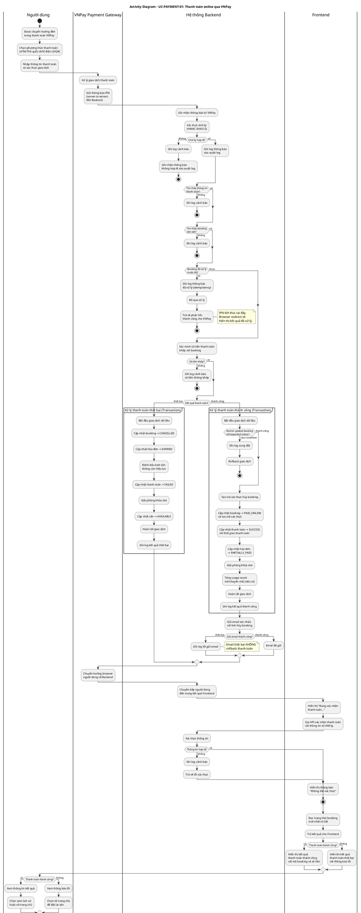

# Use Case UC-PAYMENT-01: Thanh toán online qua VNPay

## Bảng 3.11. Đặc tả Use case Thanh toán online qua VNPay

| Thông tin | Nội dung |
|-----------|----------|
| **Tên Use case** | Thanh toán online qua VNPay |
| **Mã Use case** | UC-PAYMENT-01 |
| **Mô tả Use case** | Là khách hàng hoặc khách vãng lai, tôi muốn thanh toán đơn đặt sân online qua cổng thanh toán VNPay để xác nhận booking và nhận email xác nhận với link hủy đặt sân. |
| **Tác nhân** | Khách hàng hoặc Khách vãng lai |
| **Tác nhân phụ** | VNPay Payment Gateway, Email Service |
| **Mức độ ưu tiên** | Cao |
| **Điều kiện kích hoạt** | Người dùng xác nhận đặt sân online và hệ thống chuyển hướng sang cổng thanh toán VNPay. |
| **Điều kiện tiên quyết** | • Người dùng đã tạo booking online thành công (UC-BOOKING-01: Đặt sân online). • Booking ở trạng thái chờ thanh toán (PENDING). • Booking chưa hết hạn thanh toán. • Hệ thống đã tích hợp với cổng thanh toán VNPay. |
| **Điều kiện cuối** | **Thanh toán thành công:** • Booking được cập nhật trạng thái thành "Đã thanh toán online" (PAID_ONLINE) với thông tin mã xác thực và thời hạn hủy booking. • Thông tin thanh toán được cập nhật với trạng thái thành công và thời gian thanh toán. • Hóa đơn được cập nhật trạng thái thanh toán phù hợp. • Khóa slot tạm thời được giải phóng. • Số lượt sử dụng mã khuyến mãi được cập nhật nếu có. • Email xác nhận được gửi cho người dùng với link hủy booking (nếu gửi thành công).  **Thanh toán thất bại:** • Booking được cập nhật trạng thái thành "Đã hủy" (CANCELLED) với nguồn hủy từ hệ thống. • Thông tin thanh toán được cập nhật với trạng thái thất bại. • Hóa đơn được đánh dấu hết hạn thanh toán. • Khóa slot tạm thời được giải phóng. • Các lượt sân trong booking được đánh dấu không còn hiệu lực. • Các sân được cập nhật về trạng thái "Sẵn sàng" (AVAILABLE). |

---

## Luồng chính

1. Người dùng được chuyển hướng đến trang thanh toán VNPay sau khi tạo booking online thành công.
2. Người dùng chọn phương thức thanh toán trên VNPay (thẻ ATM, thẻ quốc tế, ví điện tử, hoặc QR code).
3. Người dùng nhập thông tin thanh toán và xác thực giao dịch theo yêu cầu.
4. VNPay xử lý giao dịch và gửi thông báo kết quả về hệ thống.
5. Hệ thống ghi nhận thông báo từ VNPay.
6. Hệ thống xác thực tính hợp lệ của thông báo từ VNPay.
7. Hệ thống ghi log thông báo thanh toán vào hệ thống để audit.
8. Hệ thống kiểm tra xem booking đã được xử lý trước đó chưa để tránh xử lý trùng lặp.
9. Hệ thống xác minh số tiền thanh toán khớp với số tiền trong đơn đặt sân.
10. Hệ thống bắt đầu cập nhật dữ liệu trong một giao dịch an toàn.
11. Hệ thống tạo mã xác thực để người dùng có thể hủy booking qua email.
12. Hệ thống cập nhật trạng thái booking thành đã thanh toán online và lưu thông tin mã xác thực.
13. Hệ thống cập nhật thông tin thanh toán thành trạng thái thành công và ghi nhận thời gian thanh toán.
14. Hệ thống cập nhật trạng thái thanh toán của hóa đơn phù hợp.
15. Hệ thống giải phóng các khóa slot tạm thời của booking.
16. Hệ thống cập nhật số lượt sử dụng của mã khuyến mãi nếu booking có áp dụng.
17. Hệ thống hoàn tất giao dịch cập nhật dữ liệu.
18. Hệ thống gửi email xác nhận cho người dùng với thông tin booking và link hủy booking (nếu gửi thành công).
19. VNPay chuyển hướng trình duyệt người dùng về hệ thống, sau đó hệ thống chuyển tiếp người dùng đến trang kết quả thanh toán trên Frontend.
20. Frontend hiển thị thông báo "Đang xác nhận thanh toán..." cho người dùng.
21. Frontend gọi API xác nhận thanh toán với thông tin từ VNPay.
22. Hệ thống xác thực lại thông tin thanh toán, đọc trạng thái booking mới nhất và trả kết quả cho Frontend.
23. Frontend hiển thị kết quả thanh toán thành công với mã booking và số tiền đã thanh toán.
24. Người dùng xem thông tin kết quả và chọn xem lịch sử đặt sân hoặc về trang chủ.

---

## Luồng thay thế

### (6a) Xác thực thông báo từ VNPay thất bại
- Thông tin xác thực từ VNPay không hợp lệ hoặc bị thay đổi.

**Bước 6a.1:** Hệ thống ghi log cảnh báo về xác thực thất bại.

**Bước 6a.2:** Hệ thống ghi nhận thông báo không hợp lệ vào log audit với đánh dấu không hợp lệ.

**Bước 6a.3:** Hệ thống dừng xử lý thanh toán.

**Bước 6a.4:** Use case kết thúc.

### (8a) Booking đã được xử lý trước đó
- Booking đã ở trạng thái đã thanh toán hoặc đã hủy (VNPay có thể gửi thông báo nhiều lần).

**Bước 8a.1:** Hệ thống ghi log thông báo booking đã được xử lý trước đó.

**Bước 8a.2:** Hệ thống bỏ qua xử lý để tránh cập nhật trùng lặp.

**Bước 8a.3:** Hệ thống trả về phản hồi thành công cho VNPay và kết thúc xử lý thông báo từ VNPay.

**Bước 8a.4:** Khi trình duyệt được VNPay chuyển hướng về Frontend, hệ thống sẽ đọc trạng thái đã xử lý để hiển thị kết quả.

### (9a) Số tiền thanh toán không khớp
- Số tiền từ VNPay khác với số tiền trong thông tin thanh toán của booking.

**Bước 9a.1:** Hệ thống ghi log cảnh báo về số tiền không khớp.

**Bước 9a.2:** Hệ thống dừng xử lý thanh toán.

**Bước 9a.3:** Use case kết thúc.

### (12a) Xung đột khi cập nhật booking
- Có nhiều yêu cầu cập nhật booking cùng lúc.

**Bước 12a.1:** Hệ thống kiểm tra điều kiện booking trước khi cập nhật.

**Bước 12a.2:** Nếu điều kiện không còn thỏa mãn (booking đã được cập nhật), hệ thống rollback giao dịch dữ liệu.

**Bước 12a.3:** Hệ thống ghi log về xung đột dữ liệu.

**Bước 12a.4:** Use case kết thúc (yêu cầu đầu tiên đã xử lý thành công).

### (18a) Gửi email thất bại
- Lỗi khi gửi email xác nhận (lỗi kết nối, email không hợp lệ).

**Bước 18a.1:** Hệ thống ghi log lỗi gửi email.

**Bước 18a.2:** Hệ thống KHÔNG rollback giao dịch thanh toán (booking vẫn được xác nhận thành công).

**Bước 18a.3:** Người dùng vẫn có thể xem thông tin booking trong lịch sử đặt sân.

**Bước 18a.4:** Tiếp tục từ bước 19 (chuyển hướng về Frontend).

### (Luồng thanh toán thất bại)
- VNPay trả về kết quả thanh toán thất bại (người dùng hủy, không đủ tiền, thẻ bị khóa, v.v.).

**Thay thế từ bước 10:**

**Bước 10b.1:** Hệ thống bắt đầu cập nhật dữ liệu trong một giao dịch an toàn.

**Bước 10b.2:** Hệ thống cập nhật trạng thái booking thành đã hủy với nguồn hủy từ hệ thống.

**Bước 10b.3:** Hệ thống cập nhật trạng thái hóa đơn thành hết hạn thanh toán.

**Bước 10b.4:** Hệ thống đánh dấu các lượt sân trong booking không còn hiệu lực.

**Bước 10b.5:** Hệ thống cập nhật thông tin thanh toán thành trạng thái thất bại.

**Bước 10b.6:** Hệ thống giải phóng các khóa slot tạm thời.

**Bước 10b.7:** Hệ thống cập nhật tất cả sân liên quan về trạng thái sẵn sàng để cho người dùng khác đặt.

**Bước 10b.8:** Hệ thống hoàn tất giao dịch cập nhật dữ liệu.

**Bước 10b.9:** Hệ thống ghi log kết quả xử lý thanh toán thất bại.

**Bước 10b.10:** Tiếp tục từ bước 19 (chuyển hướng về Frontend với thông báo thất bại).

**Bước 23b:** Frontend hiển thị kết quả thanh toán thất bại với thông báo lỗi cụ thể theo mã lỗi từ VNPay.

**Bước 24b:** Người dùng chọn về trang chủ để đặt lại sân nếu muốn.

---

## Luồng ngoại lệ

### (5a) Không tìm thấy thông tin thanh toán
- Hệ thống không tìm thấy thông tin thanh toán liên kết với mã giao dịch từ VNPay.

**Bước 5a.1:** Hệ thống ghi log cảnh báo về thông tin thanh toán không tồn tại.

**Bước 5a.2:** Hệ thống dừng xử lý thông báo từ VNPay.

**Bước 5a.3:** Use case kết thúc.

### (5b) Không tìm thấy booking liên kết
- Hệ thống không tìm thấy booking liên kết với thông tin thanh toán.

**Bước 5b.1:** Hệ thống ghi log cảnh báo về booking không tồn tại.

**Bước 5b.2:** Hệ thống dừng xử lý thông báo từ VNPay.

**Bước 5b.3:** Use case kết thúc.

### (17a) Lỗi hệ thống hoặc lỗi cơ sở dữ liệu
- Hệ thống gặp lỗi không mong muốn trong quá trình cập nhật dữ liệu.

**Bước 17a.1:** Hệ thống rollback toàn bộ giao dịch dữ liệu để đảm bảo tính nhất quán.

**Bước 17a.2:** Hệ thống ghi log chi tiết lỗi để hỗ trợ khắc phục.

**Bước 17a.3:** Booking giữ nguyên trạng thái chờ thanh toán để người dùng có thể thử lại sau khi hệ thống phục hồi.

**Bước 17a.4:** Use case kết thúc.

### (22a) Xác thực thông tin từ Frontend thất bại
- Thông tin thanh toán từ Frontend không hợp lệ hoặc bị thay đổi.

**Bước 22a.1:** Hệ thống ghi log cảnh báo về xác thực thất bại.

**Bước 22a.2:** Hệ thống trả về lỗi xác thực cho Frontend.

**Bước 22a.3:** Frontend hiển thị thông báo lỗi "Không thể xác thực thông tin thanh toán".

**Bước 22a.4:** Use case kết thúc.

---

## Thông tin bổ sung

### Quy tắc nghiệp vụ

1. **Xử lý không trùng lặp (Idempotency)**: VNPay có thể gửi thông báo thanh toán nhiều lần do cơ chế retry. Hệ thống kiểm tra trạng thái booking trước khi xử lý để đảm bảo mỗi giao dịch chỉ được xử lý một lần duy nhất. Nếu booking đã ở trạng thái đã thanh toán hoặc đã hủy, hệ thống bỏ qua xử lý và trả về phản hồi thành công ngay lập tức.

2. **Cập nhật dữ liệu an toàn (Atomic Update)**: Khi nhiều yêu cầu cập nhật booking cùng lúc (IPN từ VNPay và API xác nhận từ Frontend), hệ thống sử dụng cơ chế kiểm tra điều kiện trước khi cập nhật để đảm bảo chỉ một yêu cầu thành công. Yêu cầu thứ hai sẽ phát hiện booking đã được cập nhật và dừng xử lý để tránh xung đột dữ liệu.

3. **Giao dịch dữ liệu (Transaction)**: Toàn bộ quá trình cập nhật booking, thanh toán, hóa đơn, khóa slot, và mã khuyến mãi được thực hiện trong một giao dịch dữ liệu. Nếu bất kỳ bước nào thất bại, toàn bộ giao dịch sẽ được rollback để đảm bảo dữ liệu không bị rối loạn.

4. **Xác thực chữ ký (Signature Verification)**: Mọi thông báo từ VNPay phải được xác thực chữ ký bằng thuật toán HMAC-SHA512 với khóa bí mật được cung cấp bởi VNPay. Thông báo có chữ ký không hợp lệ sẽ bị từ chối và ghi log cảnh báo để phòng chống gian lận.

5. **Kiểm tra số tiền (Amount Verification)**: Hệ thống so sánh số tiền thanh toán từ VNPay với số tiền trong thông tin thanh toán của booking. Nếu số tiền không khớp, hệ thống dừng xử lý và ghi log cảnh báo để phòng chống thao tác bất hợp pháp.

6. **Hết hạn mã xác thực hủy booking (Cancel Token Expiry)**: Mã xác thực để người dùng hủy booking qua email có thời hạn tối đa 24 giờ hoặc đến khi booking bắt đầu (tùy thời điểm nào đến trước). Sau thời hạn này, người dùng không thể hủy booking qua email mà phải liên hệ quầy để được hỗ trợ.

7. **Sử dụng mã khuyến mãi (Promotion Usage)**: Sau khi thanh toán thành công, hệ thống tăng số lượt sử dụng của mã khuyến mãi (nếu có) để đảm bảo giới hạn sử dụng được áp dụng đúng. Điều này ngăn người dùng sử dụng mã khuyến mãi vượt quá giới hạn cho phép.

8. **Giải phóng khóa slot (Slot Lock Cleanup)**: Sau khi thanh toán thành công hoặc thất bại, hệ thống giải phóng các khóa slot tạm thời được tạo khi đặt sân. Điều này đảm bảo slot không bị khóa vô thời hạn và có thể được người dùng khác đặt.

9. **Cập nhật trạng thái sân (Court Status Update)**: Khi thanh toán thất bại, hệ thống cập nhật tất cả các sân liên quan về trạng thái sẵn sàng để người dùng khác có thể đặt ngay. Khi thanh toán thành công, trạng thái sân sẽ được cập nhật bởi tác vụ tự động khi đến giờ bắt đầu booking.

10. **Ưu tiên xử lý thông báo từ VNPay (IPN vs Confirm Priority)**: Thông báo từ VNPay (IPN) có độ tin cậy cao hơn API xác nhận từ Frontend vì đây là kênh server-to-server được bảo vệ bằng chữ ký. Hệ thống ưu tiên xử lý IPN để cập nhật trạng thái booking, còn API xác nhận chủ yếu dùng để hiển thị kết quả cho người dùng.

11. **Ánh xạ mã lỗi từ VNPay (Response Code Mapping)**: Hệ thống ánh xạ mã phản hồi từ VNPay thành thông báo lỗi dễ hiểu cho người dùng (ví dụ: mã "24" = "Khách hàng hủy giao dịch", mã "51" = "Tài khoản không đủ số dư"). Điều này giúp người dùng hiểu rõ lý do giao dịch thất bại.

### Yêu cầu phi chức năng

1. **Bảo mật**: 
   - Mọi thông báo từ VNPay phải được xác thực chữ ký bằng HMAC-SHA512 trước khi xử lý.
   - Mã xác thực hủy booking được băm bằng SHA256 trước khi lưu vào cơ sở dữ liệu để bảo vệ khỏi truy cập trái phép.
   - Thông tin thanh toán nhạy cảm (số thẻ, mã CVV) không được lưu trữ trong hệ thống mà chỉ lưu mã giao dịch từ VNPay.

2. **Hiệu năng**: 
   - Thao tác xử lý thông báo từ VNPay cần hoàn thành trong thời gian hợp lý (dưới 3 giây) để VNPay không retry gửi lại.
   - API xác nhận thanh toán cần trả về kết quả nhanh chóng (dưới 1 giây) để người dùng không phải chờ đợi lâu.

3. **Độ tin cậy**: 
   - Hệ thống phải xử lý đúng trường hợp VNPay gửi thông báo nhiều lần (idempotency).
   - Hệ thống phải rollback giao dịch khi gặp lỗi để đảm bảo dữ liệu không bị rối loạn.
   - Email xác nhận thất bại không được ảnh hưởng đến trạng thái thanh toán thành công.

4. **Khả năng mở rộng**: 
   - Thiết kế cho phép tích hợp thêm các cổng thanh toán khác (MoMo, ZaloPay, v.v.) mà không cần thay đổi luồng chính.
   - Cơ chế xử lý không trùng lặp và giao dịch dữ liệu đảm bảo hệ thống hoạt động ổn định khi lượng giao dịch tăng cao.

5. **Khả năng quan sát**: 
   - Hệ thống ghi log tất cả các thông báo từ VNPay (bao gồm cả thông báo không hợp lệ) để hỗ trợ kiểm tra và đối soát.
   - Mỗi lần xử lý thanh toán thành công hoặc thất bại đều được ghi log với thông tin chi tiết (booking ID, mã giao dịch, số tiền, kết quả) để hỗ trợ audit và khắc phục sự cố.

### Tích hợp với các Use Case khác

**UC-BOOKING-01 (Đặt sân online)**: Use case này là điều kiện tiên quyết của UC-PAYMENT-01. Người dùng phải tạo booking online thành công (trạng thái PENDING) trước khi được chuyển hướng sang trang thanh toán VNPay. Thông tin thanh toán và hóa đơn được tạo sẵn trong UC-BOOKING-01 để UC-PAYMENT-01 chỉ cần cập nhật trạng thái.

**UC-BOOKING-03 (Hủy booking online)**: Sau khi thanh toán thành công, người dùng nhận được email xác nhận kèm link hủy booking với mã xác thực. Người dùng có thể sử dụng link này để kích hoạt UC-BOOKING-03 và hủy booking trong thời hạn cho phép (24 giờ hoặc trước giờ bắt đầu).

**UC-BOOKING-05 (Check-in khách hàng)**: Sau khi thanh toán thành công (UC-PAYMENT-01), booking ở trạng thái đã thanh toán online (PAID_ONLINE). Khi khách hàng đến sân đúng giờ, nhân viên sẽ thực hiện UC-BOOKING-05 để xác nhận khách hàng đã đến và chuyển trạng thái booking thành đang chơi (IN_PROGRESS).

**UC-BOOKING-06 (Check-out khách hàng)**: Sau khi khách hàng chơi xong, nhân viên thực hiện UC-BOOKING-06 để kết thúc booking. Nếu có phí dịch vụ phát sinh, nhân viên sẽ thu tiền mặt tại quầy và hoàn tất thanh toán. Booking chuyển sang trạng thái đã hoàn thành (COMPLETED) và khách hàng được tích điểm thành viên.

---

## Sơ đồ hoạt động (Activity Diagram)

---

## Sơ đồ tuần tự (Sequence Diagram)

```plantuml
@startuml
title Sequence Diagram - UC-PAYMENT-01: Thanh toán online qua VNPay

actor "Người dùng" as User
participant "Browser" as Browser
participant "VNPay\nPayment Gateway" as VNPay
participant "Backend\n(IPN Handler)" as Backend
participant "Backend\n(Callback Handler)" as CallbackHandler
participant "Frontend\n(Payment Result)" as Frontend
participant "Database" as DB
participant "Email Service" as Email

== Bước 1-4: Thanh toán trên VNPay ==
User -> Browser: Được chuyển hướng\nđến VNPay
activate Browser
Browser -> VNPay: Mở trang thanh toán
activate VNPay

User -> VNPay: Chọn phương thức thanh toán\n(ATM/Thẻ/Ví/QR)
User -> VNPay: Nhập thông tin\nvà xác thực

VNPay -> VNPay: Xử lý giao dịch\nthanh toán

== Bước 5-18: VNPay IPN (Server-to-Server) ==
VNPay -> Backend: POST /api/payment/vnpay/ipn\n(Thông báo thanh toán)
activate Backend

Backend -> Backend: Ghi nhận thông báo
Backend -> Backend: Xác thực chữ ký\n(HMAC-SHA512)

alt Chữ ký không hợp lệ
    Backend -> Backend: Ghi log cảnh báo
    Backend -> DB: Ghi audit log\n(isValid=false)
    activate DB
    DB --> Backend: OK
    deactivate DB
    Backend --> VNPay: HTTP 200 (silent)
    deactivate Backend
    note right: Dừng xử lý
else Chữ ký hợp lệ
    Backend -> DB: Ghi audit log\n(isValid=true)
    activate DB
    DB --> Backend: OK
    deactivate DB
    
    Backend -> DB: Tìm payment\nbằng transactionRef
    DB --> Backend: Payment record
    
    Backend -> DB: Lấy booking liên kết
    DB --> Backend: Booking data
    
    alt Booking đã được xử lý (PAID_ONLINE/CANCELLED)
        Backend -> Backend: Ghi log idempotency
        Backend --> VNPay: HTTP 200 OK
        deactivate Backend
        note right: Bỏ qua xử lý trùng lặp
    else Booking chưa xử lý (PENDING)
        Backend -> Backend: Xác minh số tiền thanh toán
        
        alt Thanh toán thành công
            Backend -> DB: BEGIN TRANSACTION
            activate DB
            
            Backend -> DB: Atomic update booking\n(status=PENDING → PAID_ONLINE)
            
            alt Race condition (booking đã update)
                DB --> Backend: 0 rows affected
                Backend -> DB: ROLLBACK
                Backend -> Backend: Ghi log race condition
                Backend --> VNPay: HTTP 200 OK
                deactivate DB
                deactivate Backend
            else Update thành công
                Backend -> Backend: Tạo cancel token
                DB --> Backend: 1 row affected
                
                Backend -> DB: Update payment → SUCCESS
                Backend -> DB: Update invoice → PARTIALLY_PAID
                Backend -> DB: Delete slot locks
                Backend -> DB: Increment promotion usage\n(nếu có)
                Backend -> DB: COMMIT TRANSACTION
                deactivate DB
                
                Backend -> Backend: Ghi log thành công
                
                Backend -> Email: Gửi email xác nhận\nvới cancel token
                activate Email
                
                alt Gửi email thất bại
                    Email --> Backend: Error
                    Backend -> Backend: Ghi log lỗi email
                    note right: Không rollback thanh toán
                else Gửi email thành công
                    Email --> Backend: Email sent
                    deactivate Email
                end
                
                Backend --> VNPay: HTTP 200 OK
                deactivate Backend
            end
            
        else Thanh toán thất bại
            Backend -> DB: BEGIN TRANSACTION
            activate DB
            Backend -> DB: Update booking → CANCELLED
            Backend -> DB: Update invoice → EXPIRED
            Backend -> DB: Deactivate booking courts
            Backend -> DB: Update payment → FAILED
            Backend -> DB: Delete slot locks
            Backend -> DB: Update courts → AVAILABLE
            Backend -> DB: COMMIT TRANSACTION
            deactivate DB
            
            Backend -> Backend: Ghi log thất bại
            Backend --> VNPay: HTTP 200 OK
            deactivate Backend
        end
    end
end

== Bước 19: VNPay Callback (Browser Redirect) ==
VNPay -> Browser: HTTP 302 Redirect\nđến Backend callback URL
Browser -> CallbackHandler: GET /api/payment/vnpay/callback\n(query params)
activate CallbackHandler

CallbackHandler -> CallbackHandler: Xác thực chữ ký

alt Chữ ký không hợp lệ
    CallbackHandler -> Browser: HTTP 302 Redirect\nđến Frontend (error)
    deactivate CallbackHandler
else Chữ ký hợp lệ
    CallbackHandler -> CallbackHandler: Parse thông tin thanh toán
    CallbackHandler -> Browser: HTTP 302 Redirect\nđến Frontend (with params)
    deactivate CallbackHandler
end

== Bước 20-24: Frontend hiển thị kết quả ==
Browser -> Frontend: Load trang kết quả\nthanh toán
deactivate Browser
activate Frontend

Frontend -> User: Hiển thị "Đang xác nhận\nthanh toán..."

Frontend -> Backend: GET /api/payment/vnpay/confirm\n(query params)
activate Backend

Backend -> Backend: Xác thực thông tin

alt Thông tin không hợp lệ
    Backend --> Frontend: HTTP 400 Bad Request
    Frontend -> User: Hiển thị lỗi xác thực
    deactivate Backend
    deactivate Frontend
else Thông tin hợp lệ
    Backend -> DB: Đọc trạng thái booking\nmới nhất (AsNoTracking)
    activate DB
    DB --> Backend: Booking status
    deactivate DB
    
    Backend --> Frontend: Kết quả thanh toán
    deactivate Backend
    
    alt Thanh toán thành công
        Frontend -> User: Hiển thị kết quả\nthanh toán thành công\n(mã booking, số tiền)
        User -> Frontend: Chọn xem lịch sử\nhoặc về trang chủ
    else Thanh toán thất bại
        Frontend -> User: Hiển thị kết quả\nthanh toán thất bại\n(thông báo lỗi theo mã)
        User -> Frontend: Chọn về trang chủ\nđể đặt lại sân
    end
    
    deactivate Frontend
end

@enduml
```

