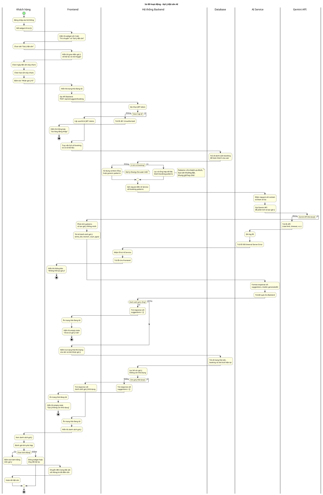
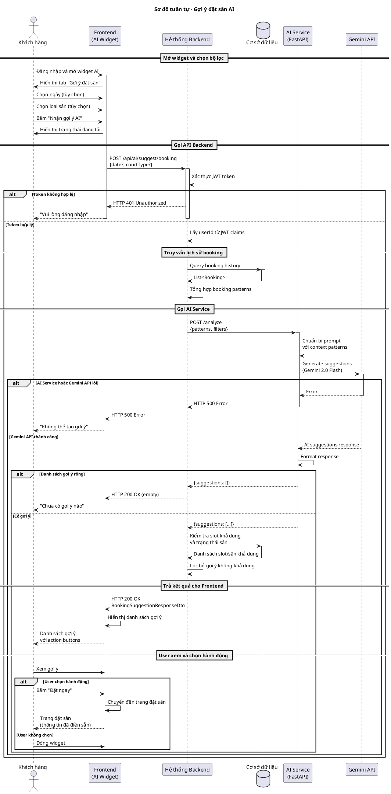

# Use Case UC-AI-01: Gợi ý đặt sân AI

## Bảng 3.12. Đặc tả Use case Gợi ý đặt sân AI

| Thông tin | Nội dung |
|-----------|----------|
| **Tên Use case** | Gợi ý đặt sân AI |
| **Mã Use case** | UC-AI-01 |
| **Mô tả Use case** | Là khách hàng, tôi muốn nhận gợi ý thông minh từ AI về thời gian, chi nhánh và loại sân phù hợp dựa trên lịch sử đặt sân của tôi để có trải nghiệm đặt sân nhanh chóng và phù hợp với thói quen cá nhân. |
| **Tác nhân** | Khách hàng |
| **Tác nhân phụ** | Hệ thống Backend, Cơ sở dữ liệu, AI Service (FastAPI), Gemini API |
| **Mức độ ưu tiên** | Trung bình |
| **Điều kiện kích hoạt** | Khách hàng mở widget AI trợ lý và chọn tab "Gợi ý đặt sân", hoặc khách hàng truy cập trang đặt sân và bấm nút "Nhận gợi ý AI". |
| **Điều kiện tiên quyết** | • Khách hàng đã đăng nhập vào hệ thống. • AI Service đang hoạt động và kết nối với Gemini API. • Hệ thống có thể truy xuất dữ liệu booking hoặc dữ liệu xu hướng chung để tạo gợi ý. |
| **Điều kiện cuối** | • Khách hàng nhận được danh sách gợi ý từ AI về thời gian đặt sân, chi nhánh hoặc loại sân phù hợp. • Mỗi gợi ý bao gồm tiêu đề, mô tả lý do, và hành động đề xuất. • Thông tin gợi ý được hiển thị cho khách hàng xem và lựa chọn. • Thời điểm tạo gợi ý được ghi nhận để khách hàng biết độ mới của thông tin. |

---

## Luồng chính

1. Khách hàng đăng nhập vào hệ thống.
2. Khách hàng mở widget AI trợ lý từ góc màn hình.
3. Hệ thống hiển thị widget AI với 2 tab: "Trò chuyện" và "Gợi ý đặt sân".
4. Khách hàng chọn tab "Gợi ý đặt sân".
5. Hệ thống hiển thị giao diện gợi ý với bộ lọc tùy chọn (ngày, loại sân) và nút "Nhận gợi ý AI".
6. Khách hàng có thể chọn ngày đặt sân mong muốn (tùy chọn).
7. Khách hàng có thể chọn loại sân từ dropdown (tùy chọn).
8. Khách hàng bấm nút "Nhận gợi ý AI".
9. Hệ thống hiển thị trạng thái đang tải với thông báo "Đang phân tích...".
10. Frontend gọi API Backend để yêu cầu gợi ý đặt sân với các tham số đã chọn.
11. Backend xác thực token và lấy userId từ JWT claims.
12. Backend truy vấn lịch sử booking của khách hàng từ cơ sở dữ liệu.
13. Backend lọc và tổng hợp dữ liệu thành các pattern (chi nhánh ưa thích, loại sân thường đặt, khung giờ hay đặt, ngày trong tuần).
14. Backend gửi yêu cầu đến AI Service với context booking patterns và các tham số lọc.
15. AI Service phân tích patterns và tạo gợi ý thông minh bằng Gemini API.
16. AI Service trả về danh sách gợi ý (3 loại: time_slot, branch, court_type) cho Backend.
17. Backend kiểm tra trạng thái khả dụng của sân và slot được gợi ý từ cơ sở dữ liệu.
18. Backend lọc bỏ các gợi ý không còn khả dụng (slot đã đặt hoặc sân không hoạt động).
19. Backend trả danh sách gợi ý hợp lệ cho Frontend.
20. Frontend ẩn trạng thái đang tải và hiển thị danh sách gợi ý.
21. Mỗi gợi ý được hiển thị dạng thẻ với tiêu đề, mô tả lý do và nút hành động.
22. Khách hàng xem danh sách gợi ý và đánh giá tính phù hợp.
23. Khách hàng có thể bấm nút hành động trên gợi ý để thực hiện đặt sân.
24. Hệ thống chuyển khách hàng đến trang đặt sân với các thông tin từ gợi ý đã được điền sẵn.

---

## Luồng thay thế

### (6a) Khách hàng bỏ qua chọn ngày
- Khách hàng không chọn ngày trong bộ lọc.
- Hệ thống sử dụng giá trị mặc định rỗng (empty) cho tham số date.
- AI sẽ gợi ý dựa trên patterns chung mà không giới hạn ngày cụ thể.
- Use case tiếp tục từ bước 8.

### (7a) Khách hàng bỏ qua chọn loại sân
- Khách hàng không chọn loại sân trong bộ lọc.
- Hệ thống sử dụng giá trị "Tất cả loại sân" cho tham số courtType.
- AI sẽ gợi ý dựa trên loại sân mà khách hàng thường đặt trong lịch sử.
- Use case tiếp tục từ bước 8.

### (12a) Khách hàng chưa có lịch sử booking
- Backend truy vấn cơ sở dữ liệu và không tìm thấy booking nào đã hoàn thành của khách hàng.
- Backend gửi yêu cầu đến AI Service với context rỗng hoặc generic patterns.
- AI Service trả về gợi ý chung dựa trên dữ liệu thống kê tổng hợp của hệ thống (không personalized).
- Frontend hiển thị gợi ý chung với thông báo "Gợi ý dựa trên xu hướng chung".
- Use case tiếp tục từ bước 20.

### (22a) Khách hàng không thực hiện hành động trên gợi ý
- Khách hàng xem gợi ý nhưng không bấm nút hành động.
- Khách hàng có thể đóng widget hoặc thay đổi bộ lọc để nhận gợi ý mới.
- Use case kết thúc hoặc quay lại bước 6.

---

## Luồng ngoại lệ

### (11a) Khách hàng chưa đăng nhập
- Hệ thống phát hiện token JWT không hợp lệ hoặc không tồn tại.
- Hệ thống trả về lỗi 401 Unauthorized.
- Frontend hiển thị thông báo "Vui lòng đăng nhập để sử dụng tính năng này".
- Use case kết thúc.

### (14a) AI Service không khả dụng
- Backend gọi AI Service nhưng không nhận được phản hồi (timeout, connection error, service down).
- Backend ghi log lỗi và trả về lỗi 503 Service Unavailable.
- Frontend hiển thị thông báo "Dịch vụ AI tạm thời không khả dụng. Vui lòng thử lại sau".
- Use case kết thúc.

### (15a) Gemini API trả về lỗi
- AI Service gọi Gemini API nhưng nhận về lỗi (rate limit, invalid request, API key issue).
- AI Service ghi log lỗi và trả về lỗi 500 Internal Server Error.
- Backend nhận lỗi từ AI Service và trả về lỗi cho Frontend.
- Frontend hiển thị thông báo "Không thể tạo gợi ý. Vui lòng thử lại sau".
- Use case kết thúc.

### (16a) AI Service trả về danh sách gợi ý rỗng
- AI Service phân tích xong nhưng không đủ dữ liệu để tạo gợi ý hợp lý.
- AI Service trả về danh sách gợi ý rỗng (empty array).
- Frontend hiển thị trạng thái empty state với thông báo "Chưa có gợi ý nào. Thử thay đổi bộ lọc và nhận lại gợi ý".
- Use case kết thúc.

### (17a) Gợi ý không còn khả dụng
- Backend kiểm tra và phát hiện một số gợi ý không còn slot khả dụng hoặc sân đã bị đặt.
- Backend lọc bỏ các gợi ý không khả dụng trước khi trả về cho Frontend.
- Nếu còn gợi ý khả dụng, use case tiếp tục từ bước 20.
- Nếu tất cả gợi ý đều không khả dụng, Frontend hiển thị empty state với thông báo "Các gợi ý hiện không còn khả dụng. Vui lòng thử lại".
- Use case kết thúc.

### (19a) Backend gặp lỗi khi xử lý response từ AI
- Backend nhận response từ AI Service nhưng gặp lỗi khi parse hoặc validate dữ liệu.
- Backend ghi log lỗi và trả về lỗi 500 Internal Server Error.
- Frontend hiển thị thông báo "Đã xảy ra lỗi. Vui lòng thử lại sau".
- Use case kết thúc.

---

## Thông tin bổ sung

### Quy tắc nghiệp vụ

1. **Yêu cầu đăng nhập bắt buộc**: Chức năng gợi ý đặt sân AI chỉ dành cho khách hàng đã đăng nhập (CUSTOMER role). Hệ thống sử dụng JWT token để xác thực và lấy userId để truy vấn lịch sử booking cá nhân.

2. **Personalization dựa trên lịch sử**: Nếu khách hàng có lịch sử booking, AI phân tích các booking đã hoàn thành để xác định patterns (chi nhánh ưa thích, loại sân thường đặt, khung giờ hay chơi, ngày trong tuần). Patterns này được sử dụng làm context để tạo gợi ý phù hợp với thói quen cá nhân. Nếu khách hàng chưa có lịch sử, AI sử dụng dữ liệu thống kê tổng hợp của hệ thống, không chứa thông tin cá nhân của người dùng khác, để tạo gợi ý chung.

3. **Bảo mật thông tin cá nhân**: Chỉ booking patterns được gửi đến AI Service (tên chi nhánh, loại sân, khung giờ, giá tiền). Không gửi thông tin nhạy cảm như BookingId, PaymentId, email, số điện thoại, tên đầy đủ. Hệ thống đảm bảo tuân thủ nguyên tắc "minimum data exposure" khi tích hợp AI.

4. **Bộ lọc tùy chọn (Optional Filters)**: Khách hàng có thể chọn ngày đặt sân và loại sân để giới hạn phạm vi gợi ý. Nếu không chọn, AI sẽ gợi ý dựa trên patterns chung. Bộ lọc giúp khách hàng kiểm soát kết quả gợi ý theo nhu cầu cụ thể.

5. **Ba loại gợi ý chính**: Hệ thống hỗ trợ 3 loại gợi ý AI:
   - **time_slot**: Gợi ý khung giờ phù hợp dựa trên thời gian khách hàng thường đặt.
   - **branch**: Gợi ý chi nhánh dựa trên vị trí khách hàng thường chơi.
   - **court_type**: Gợi ý loại sân dựa trên loại sân khách hàng thường đặt.

6. **Kiểm tra khả dụng**: Backend kiểm tra trạng thái khả dụng của sân và slot được gợi ý trước khi trả kết quả cho Frontend. Các gợi ý không còn khả dụng (slot đã đặt hoặc sân không hoạt động) sẽ bị lọc bỏ để đảm bảo khách hàng chỉ nhận gợi ý có thể đặt được.

7. **Hành động nhanh (Quick Actions)**: Mỗi gợi ý có nút hành động (action button) để khách hàng thực hiện đặt sân ngay. Ví dụ: "Đặt ngay", "Xem chi nhánh", "Chọn loại sân". Nút hành động chuyển khách hàng đến trang đặt sân với thông tin từ gợi ý đã điền sẵn.

8. **Gợi ý chung khi không có lịch sử**: Nếu khách hàng chưa có lịch sử booking, AI trả về gợi ý chung (generic suggestions) dựa trên dữ liệu thống kê tổng hợp của toàn hệ thống, không chứa thông tin cá nhân của người dùng khác. Điều này đảm bảo khách hàng mới vẫn có trải nghiệm sử dụng AI.

9. **Rate limiting bảo vệ hệ thống**: Endpoint AI có rate limit 20 requests/phút cho mỗi user (ai-user policy) để tránh lạm dụng và bảo vệ chi phí Gemini API. Nếu vượt quá giới hạn, hệ thống trả về lỗi 429 Too Many Requests.

10. **Timestamp cho độ mới của gợi ý**: Mỗi response AI có trường `generatedAt` để khách hàng biết gợi ý được tạo khi nào. Gợi ý cũ có thể không còn phù hợp nếu slot đã bị đặt hoặc patterns thay đổi.

11. **Model AI sử dụng**: Hệ thống sử dụng Gemini 2.0 Flash (hoặc phiên bản mới hơn) để tạo gợi ý. Model được cấu hình ở AI Service và có thể thay đổi mà không ảnh hưởng đến Backend.

### Thông tin bổ sung về giao diện

Để nâng cao trải nghiệm người dùng, giao diện gợi ý AI được thiết kế với các đặc điểm sau:

- **Widget AI**: Hiển thị dưới dạng floating button ở góc màn hình, có thể mở/đóng dễ dàng.
- **Loading state**: Sử dụng skeleton cards (thường 3 cards) để hiển thị trạng thái đang tải, tạo cảm giác mượt mà.
- **Màu sắc phân loại**: Mỗi loại gợi ý có màu sắc riêng để dễ phân biệt:
  - time_slot: Xanh dương, icon đồng hồ
  - branch: Xanh lá, icon vị trí
  - court_type: Vàng, icon ngôi sao
- **Responsive**: Giao diện hoạt động tốt trên cả mobile và desktop.
- **Empty state**: Khi không có gợi ý, hiển thị icon và message rõ ràng.

### Yêu cầu phi chức năng

1. **Thời gian phản hồi**: Yêu cầu gợi ý AI cần hoàn thành trong thời gian hợp lý (dưới 5 giây) để đảm bảo trải nghiệm người dùng tốt. Nếu vượt quá thời gian này, Frontend hiển thị thông báo timeout.

2. **Độ tin cậy của AI Service**: AI Service cần có độ ổn định cao để đảm bảo tính năng AI có thể sử dụng thường xuyên. Hệ thống không cache gợi ý cá nhân hóa của từng người dùng. Khi AI Service không khả dụng, hệ thống có cơ chế xử lý như hiển thị thông báo lỗi yêu cầu thử lại sau, hoặc trả về gợi ý chung dựa trên dữ liệu thống kê nội bộ.

3. **Bảo mật và quyền riêng tư**: Hệ thống không lưu trữ nội dung gợi ý AI cá nhân hóa trong database (stateless). Mọi request AI đều được xử lý real-time và không cache kết quả cá nhân để tránh rò rỉ thông tin riêng tư giữa các users. Hệ thống có thể cache gợi ý chung (generic suggestions) cho user mới.

4. **Cost optimization cho Gemini API**: Hệ thống giới hạn số lượng booking patterns gửi đến AI (ví dụ: tối đa 20 bookings gần nhất) để giảm token count và chi phí Gemini API. Dữ liệu được tổng hợp thành summary thay vì gửi raw booking data.

5. **Error handling graceful**: Khi AI Service gặp lỗi, hệ thống không được crash mà phải hiển thị thông báo lỗi thân thiện và cho phép khách hàng thử lại. Lỗi được ghi log để hỗ trợ debugging.

6. **Responsive UI và accessibility**: Giao diện gợi ý AI phải responsive trên mobile và desktop. Skeleton loading states giúp người dùng biết hệ thống đang xử lý. Empty states và error states cần rõ ràng với icon và message phù hợp.

7. **Rate limiting monitoring**: Hệ thống cần monitor số lượng requests AI và cảnh báo khi một user hoặc toàn hệ thống sắp vượt quá rate limit để kịp thời điều chỉnh.

### Tích hợp với các Use Case khác

**UC-BOOKING-01 (Đặt sân online)**: Sau khi khách hàng nhận gợi ý AI và bấm nút hành động (ví dụ: "Đặt ngay"), hệ thống chuyển khách hàng đến trang đặt sân online với các thông tin từ gợi ý đã được điền sẵn (chi nhánh, loại sân, khung giờ). Điều này giúp rút ngắn quy trình đặt sân và tăng conversion rate.

---

## Sơ đồ hoạt động (Activity Diagram)

---

## Sơ đồ tuần tự (Sequence Diagram)

